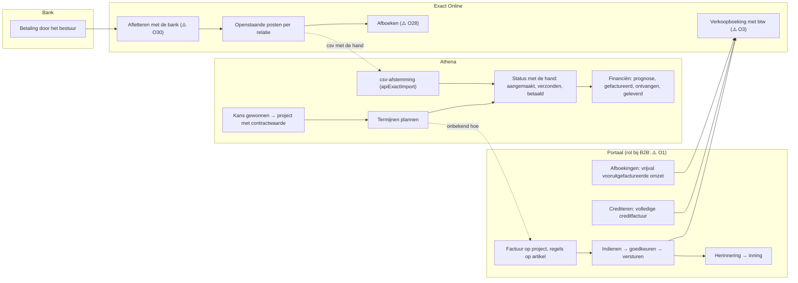
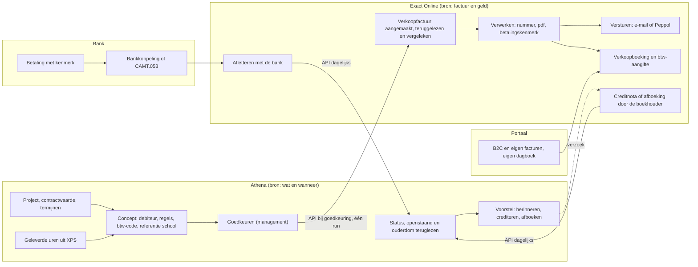
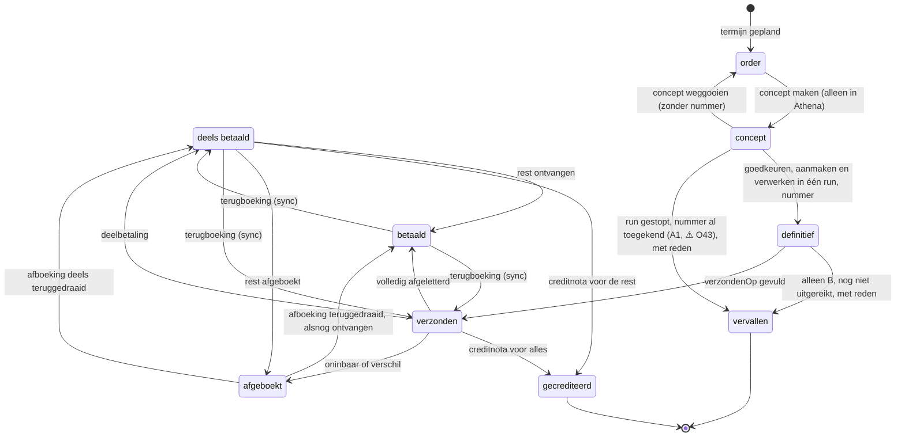
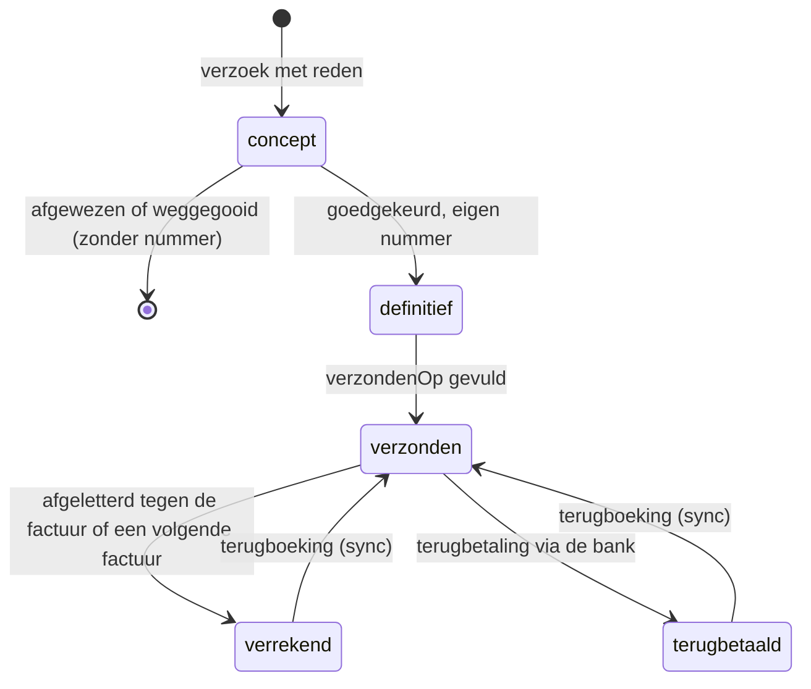

# Onderzoek facturatie en afboeken: het portaal, Athena en Exact

Peildatum: 4 november 2026. Vraag van de beheerder: kunnen we vanuit Athena factureren en afboeken zonder dubbele administratie, en welk systeem is per stap de bron: Athena, het eigen portaal ("Athena Portal", menu Financieel: Facturen, Afboekingen, Grootboekrekeningen, plus de tab Facturen bij een organisatie) of Exact Online?

Het onderzoek liep in zes delen: de financiële structuur van het portaal, de kant van Athena (`backend/Code.gs`, `index.html`, de docs), het recht (Wet OB, AWR, BW, aanbesteding, AVG), de koppelmogelijkheden van Exact Online, een verzonnen e-factuur langs de officiële validatieregels, en een eerste nabootsing met twee echte bestanden die de beheerder aanleverde.

Privacy en beveiliging. Deze repo is publiek. Hier staan alleen structuur, veldnamen, statussen, schermnamen en verhoudingen in woorden. Er staan geen namen van organisaties of personen in, geen debiteur- of factuurnummers, geen bedragen, IBAN's, aantallen of totalen die iets over de omvang zeggen. Van het portaal staan hier alleen entiteiten, veldnamen, statussen, schermnamen en handelingen in functionele termen, uit de schermen en documentatie van het portaal; er zijn geen gegevens van het portaal opgehaald of gewijzigd. De technische kant van een koppeling met het portaal hoort in een privébijlage buiten de repo. De eigen fiscale inschatting per dienstsoort hoort in een vertrouwelijk memo met de accountant, niet hier (⚠️ O15). De echte bestanden zijn alleen lokaal buiten de repo gelezen (`python3 -I`, paden als argument); de werkkopieën met echte rijen zijn daarna verwijderd. Het verzonnen voorbeeld van de e-factuur staat niet in de repo.

Aannames en punten die iemand moet bevestigen staan als ⚠️ met een code (O1, O2, …). Elke code staat in §8 met een eigenaar, de fase waarin het antwoord nodig is en een concrete vraag; O9 is vervallen.

## 0. Samenvatting en aanbeveling

Athena kan het factureren aansturen zonder dubbele administratie, maar moet daarvoor geen derde factuursysteem worden. Het portaal blijkt al een volledig order-to-cash-proces op Exact Online te hebben: een factuur hangt aan een project, de regels staan op artikelen uit de prijsafspraken van dat project, en indienen, goedkeuren, versturen, herinneren en innen lopen als procestaken; crediteren maakt altijd een volledige creditfactuur. De portaalfactuur heeft echter geen btw-velden, geen vervaldatum en geen betalingskenmerk. Athena heeft alleen termijnen als planning: één bedrag per rij, een vrij factuurnummer, statussen die elkaar vrij opvolgen, bedragen die na verzending wijzigbaar blijven en hard verwijderen. Zo voldoet Athena niet aan art. 35a, 35b en 35c Wet OB. Aanbeveling: variant A. Athena blijft de bron voor wát en wanneer er gefactureerd wordt (contract, termijnen, geleverde uren, aan welke debiteur, referentie of inkoopordernummer van de school, btw-code per dienstsoort volgens de accountant). Athena maakt per termijn een concept en zet het pas bij goedkeuring in het systeem dat al uitreikt. Dat systeem kent het nummer toe, maakt pdf en e-factuur en verstuurt. Exact boekt, matcht de bank en is de bron voor openstaand, betaald, gecrediteerd en afgeboekt, en de master voor de debiteurgegevens, de betalingsconditie en de vervaldatum (§3.1); Athena leest dat dagelijks terug via de API in plaats van via een csv. Standaard gaat het concept rechtstreeks naar Exact (A1: bij goedkeuring maakt Athena de verkoopfactuur in Exact aan en laat hem in dezelfde run verwerken; Exact nummert, maakt de pdf en verstuurt, ook via Peppol). Blijkt dat het portaal nu de B2B-facturen uitreikt en al met Exact synchroniseert, dan gaat het concept naar het portaal (A2), zodat er geen tweede uitreikend systeem bijkomt (⚠️ O1, O3). Afboeken van een oninbare post of een betalingsverschil blijft bij de boekhouder in Exact; Athena stelt voor en leest de uitkomst terug. De "Afboekingen" van het portaal zijn iets anders, namelijk de vrijval van vooruitgefactureerde omzet, en die blijven in het portaal en Exact. Twee dingen moeten eerst rond: de btw-code per dienstsoort volgens de accountant (⚠️ O15) en de debiteurgegevens van het bestuur (KvK of OIN is een fatale regel in de e-factuur). De nabootsing kon met het aangeleverde materiaal nog niet sluiten (één maand export, Openstaande posten per relatie op een eerdere peildatum, geen koppelsleutel; §6). De verzonnen voorbeeld-e-factuur kwam wel zonder fouten door de officiële regelsets (§5.6).

**Per stap het bronsysteem**

| stap | nu (⚠️ O1: beschrijving van de boekhouder ontbreekt) | straks, A1 (aanbevolen) | straks, A2 (als O1/O3 uitwijzen dat het portaal B2B uitreikt) |
|---|---|---|---|
| contract, contractwaarde, termijnplanning | Athena (`apiFacturenMaken`) | Athena | Athena |
| geleverde uren | XPS → Athena (`TalentUren`, alleen gewerkte diensten) | idem | idem |
| debiteur (bestuur): naam, KvK/OIN, factuuradres, factuur-e-mail, Peppol-id | Exact (relatie) en portaal (organisatie) los van elkaar; Athena kent alleen de school | Exact (`crm/Accounts`) is de master; Athena leest via de sync, bewaart de Exact-sleutel en houdt alleen eigen velden bij (bron per veld: §3.1, ⚠️ O51) | Exact, via de account-sync van het portaal ⚠️ O3 |
| betalingsconditie en vervaldatum | `Scholen.betaaltermijn` in Athena én de betalingsconditie in Exact ⚠️ O5 | Exact (betalingsconditie van de debiteur; Exact rekent de vervaldatum); Athena leest terug | Exact |
| artikel, btw-code, grootboekrekening | Exact, in het portaal gesynchroniseerd ⚠️ O4 | Exact; Athena leest ze als keuzelijst | idem |
| concept-factuur | portaal of een facturatiepakket ⚠️ O1 | Athena; pas bij goedkeuring in Exact | Athena; pas bij goedkeuring in het portaal |
| goedkeuren | portaal (taak) ⚠️ O6 | Athena (management, ⚠️ O40) | portaal-taak of Athena ⚠️ O40 |
| factuurnummer | portaal of Exact ⚠️ O2 | Exact (vrije nummers van het verkoopdagboek, bij invoer of bij verwerken ⚠️ O43) | portaal of Exact ⚠️ O2 |
| pdf en e-factuur | portaal of Exact ⚠️ O4 | Exact (layout, Peppol ⚠️ O32) | portaal ⚠️ O4 |
| versturen | portaal ⚠️ O6 | Exact | portaal |
| verkoopboeking en btw | Exact | Exact | Exact (verkoopfactuur-sync) |
| herinnering | portaal (taak) ⚠️ O6 | boekhouder in Exact; Athena geeft een signaal ⚠️ O28 | portaal |
| bankontvangst en afletteren | Exact ⚠️ O30 | Exact (bankkoppeling of CAMT.053) | Exact |
| openstaand, betaald | Exact; Athena met de hand of via csv (`apiExactImport`) | Exact → Athena (API, dagelijks) | Exact → Athena (API, dagelijks) |
| creditnota | portaal (alleen volledig) ⚠️ O11 | Exact, na een verzoek in Athena | portaal, na een verzoek in Athena |
| afboeken oninbaar of betalingsverschil | Exact ⚠️ O28 | Exact (boekhouder); Athena stelt voor | Exact (boekhouder) |
| vrijval vooruitgefactureerde omzet | portaal (Afboekingen) → Exact ⚠️ O10 | portaal/Exact; Athena levert "geleverd" als onderbouwing | idem |
| btw-aangifte | Exact | Exact | Exact |
| archief van de verstuurde factuur, 7 jaar | uitreikend systeem ⚠️ O1 | Exact, plus link en hash in Athena | portaal en Exact ⚠️ O4 |
| prognose en rapportage per project | Athena (Financiën v6.5) | Athena, met echte factuur- en betaaldata | idem |

## 1. Proceskaart order-to-cash

### 1.1 Nu

Wat vaststaat: Athena plant termijnen per project en zet de status met de hand; de csv-afstemming (`apiExactImport`, alleen management) zet verzend- en betaaldatum op factuurnummer. Het portaal heeft een eigen factuurmodule met een koppeling naar Exact. Exact heeft de openstaande posten. Wat niet vaststaat (⚠️ O1): welk systeem de B2B-facturen nu uitreikt, hoe een Athena-termijn in dat systeem komt, en of de verkoopfactuur-sync van het portaal naar Exact actief is (⚠️ O3). De aangeleverde facturatie-export komt waarschijnlijk uit het portaal of een facturatiepakket, niet uit Exact: de kolom "Debiteur Exact ID" is leeg en de debiteurnummers volgen een andere nummering dan de Exact-relatiecodes (§6).

### 1.2 Straks (variant A1)

Athena is de bron voor het wat en wanneer, Exact voor de factuur en het geld, de bank voor de ontvangst. Het portaal houdt de B2C-cursussen en zijn eigen facturen, het liefst met een eigen verkoopdagboek in Exact (⚠️ O27).

Het concept bestaat tot de goedkeuring alleen in Athena. Bij de goedkeuring maakt Athena de verkoopfactuur in Exact aan, leest hem terug, vergelijkt hem met het goedgekeurde concept (invariant 11) en laat hem in dezelfde run verwerken. Zo staat er nooit een concept in Exact dat iemand daar kan aanpassen of verwerken buiten de goedkeuring in Athena om, en blijft de functiescheiding intact.

Bij A2 staat het portaal tussen Athena en Exact: na de goedkeuring maakt Athena de factuur in het portaal aan met het termijn-id als externe sleutel (het portaal kent een externe sleutel en weigert een dubbele factuur), het portaal verstuurt en boekt via de verkoopfactuur-sync in Exact. Teruglezen gebeurt in beide varianten uit Exact.

## 2. Fit-gap-matrix

MoSCoW geldt voor het doel "vanuit Athena factureren zonder dubbele administratie, binnen de wet" in variant A. Must: nodig vóór de proefmaand. Should: belangrijk, maar niet blokkerend. Could: handig. Won't: nu niet. "Koppelen (Exact)" en "koppelen (portaal)" betekenen: het andere systeem blijft de bron, Athena schrijft er via de API heen of leest terug.

### 2.1 Facturen: kop

| Portaal (veld of handeling) | Athena nu | Besluit | MoSCoW | Reden |
|---|---|---|---|---|
| `code` (factuurnummer; wie het toekent is niet zichtbaar, ⚠️ O2) | vrij tekstveld, op de termijn én op het project; geen controle op uniek | koppelen (Exact; bij A2 portaal): Athena leest het nummer terug en toont het, nooit met de hand | Must | één uitreikend systeem en één reeks (art. 35a lid 1 b); wanneer het verkoopdagboek het nummer toekent ⚠️ O43 |
| `name` (Omschrijving, verplicht) | `omschrijving` van de termijn | overnemen (bestaat) | Must | aard van de dienst (art. 35a lid 1 f) |
| `externalId` (externe sleutel, uniek; het portaal weigert een dubbele factuur met dezelfde sleutel) | stabiel termijn-id, nergens buiten Athena gebruikt | overnemen: het termijn-id gaat mee als externe sleutel | Must | geen dubbele factuur na een time-out; bij A1 dezelfde rol via een eigen veld in Exact en een controle vóór het aanmaken (§5.3, ⚠️ O45) |
| `relation` (STUDENT of ORGANIZATION) | alleen scholen; geen particulieren | organisatie → nieuwe entiteit Debiteur; B2C niet doen (⚠️ O42) | Must (debiteur), Won't (B2C) | Athena kent geen cursisten |
| `invoiceTo` (Factuur voor, afwijkende betaler) | `Scholen.bestuur` als vrije tekst | overnemen: Debiteur = het bestuur (koper), school = leverlocatie | Must | KvK of OIN van de koper is een fatale e-factuurregel (NL-R-005) |
| `project` (verplicht) | `trajectId` | overnemen (bestaat) | Must | controlespoor factuur ↔ project ↔ uren (art. 35b lid 2) |
| `contacts` (meerdere) | contactpersoon als vrije tekst op het project | koppelen (Exact is de master, §3.1): één factuur-e-mailadres per debiteur, als kopie in Athena | Should | AVG: alleen wat nodig is |
| `invoiceDate` (verplicht, standaard vandaag) | `datum` is de geplande termijndatum, maar het venster noemt het veld "Factuurdatum" | overnemen: aparte factuurdatum (uitreikdatum); `datum` blijft de plandatum voor de prognose | Must | art. 35a lid 1 a; prognose en factuur lopen nu door elkaar |
| `customerReference` (Klantreferentie) | ontbreekt | overnemen: referentie en inkoopordernummer van de school op het project, standaard van de debiteur | Must | Peppol eist BuyerReference of OrderReference (PEPPOL-R003); scholen kunnen een inkoopnummer eisen (⚠️ O22) |
| `paymentMethod` (verplicht, uit Exact) | ontbreekt | niet doen in Athena: B2B is overboeking (code 58); koppelen (Exact) | Could | één betaalwijze voor B2B ⚠️ O22 |
| `milestone` (configureerbare pipeline; statusgroepen TODO, IN_PROGRESS, COMPLETE) | keuzelijst `factuurStatussen`, hernoembaar, terwijl de code de letterlijke waarden gebruikt; elke overgang mag | overnemen: een vast statusmodel (§3.2) dat niet hernoembaar is | Must | hernoemen breekt Financiën en de Exact-afstemming zonder melding (⚠️ O13) |
| `total` (alleen lezen) | `bedrag` in euro's, inclusief of exclusief btw ligt niet vast (⚠️ O12) | overnemen: berekend uit de regels, in centen | Must | art. 35a lid 1 h en j |
| `outstandingAmount` (afgeleid uit de Exact-debiteuren, ⚠️ O3) | niet opgeslagen; Financiën rekent openstaand per project uit Athena zelf | koppelen (Exact): openstaand per factuur uit Exact | Must | Exact is de bron voor geld; aftekenen tegen het debiteurensaldo |
| `creditInvoice` en `creditFor` | ontbreekt; de csv-import wist het nummer van de gecrediteerde termijn | overnemen: creditnota als eigen document met een verwijzing naar het origineel | Must | art. 34f en 35a lid 2 e: verwijzen, niet wijzigen |
| `remindersSent`, `lastReminderDate` | ontbreekt | koppelen (uitreikend systeem), in Athena als regel in het factuurlog | Should | incasso B2B (art. 6:96 BW); 14-dagenbrief bij B2C |
| `invoiceLines` (minstens één) | één bedrag per termijn | overnemen: tabel Factuurregels | Must | art. 35a lid 1 f en h; Exact eist een artikel per regel (A1) |
| ontbreekt in het portaal: btw-code, -percentage, -bedrag op kop en regel | ontbreekt ook | overnemen: btw-code per regel uit een keuzelijst die de accountant vult; koppelen (Exact-btw-code) | Must | art. 35a lid 1 i, j, l; een lege btw-code in Exact pakt de standaard van de grootboekrekening |
| ontbreekt in het portaal: vervaldatum, betaaltermijn | `Scholen.betaaltermijn` (0–365), instelling `betaaltermijnDagen` (30) | koppelen (Exact): Exact rekent de vervaldatum uit factuurdatum en betalingsconditie; Athena leest hem na het verwerken terug, zet hem vast in de factuurkop en signaleert een betalingsconditie boven het maximum voor de soort debiteur (hoogstens 30 dagen bij een overheidsinstantie, tenzij met reden) | Must | art. 6:119a/b BW; "achterstallig" kan niet zonder; één bron voor de vervaldatum (§3.1); waar hij nu ontstaat ⚠️ O5 |
| ontbreekt in het portaal: betalingskenmerk | ontbreekt; in de echte export nergens gevuld | koppelen (Exact `PaymentReference`); Athena bewaart het | Must | bankmatching (§5.4) |
| ontbreekt in het portaal: verzenddatum, factuur-e-mail | `verzonden` als datum met de hand | koppelen (uitreikend systeem); Athena leest kanaal en datum terug | Must | bewijs van uitreiken; startpunt van de rente |
| ontbreekt in het portaal: e-factuur (Peppol, UBL) | ontbreekt | koppelen (Exact via Peppol bij A1, ⚠️ O32) | Should; Must als een bestuur het eist (⚠️ O23) | Aanbestedingsbesluit art. 6; plan B2B-plicht per 1-7-2030 |
| Relatie: `identificationNumber`, `vatId`, `bankPayee`, IBAN, BIC | `Scholen`: geen KvK, btw-nummer of IBAN | koppelen (Exact is de master, §3.1): KvK of OIN en btw-id als kopie in Debiteur; IBAN alleen als hulp bij matchen, in Exact | Must (KvK/OIN), Could (IBAN) | NL-R-005; dataminimalisatie (⚠️ O7) |
| Divisie (eigen onderneming: naam, IBAN, BIC, KvK, btw-nummer) | alleen de huisstijl | overnemen in Instellingen (`bedrijf…`) of koppelen (Exact-layout) | Must bij B, Should bij A | art. 35a lid 1 c en e |

### 2.2 Facturen: regels

| Portaal (veld of handeling) | Athena nu | Besluit | MoSCoW | Reden |
|---|---|---|---|---|
| `article` (alleen met een prijsafspraak op de factuurdatum) | `soortFacturatie` en `tarief` op het project | overnemen: artikelcode per dienstsoort, keuzelijst Artikelen gespiegeld uit Exact | Must | Exact eist een artikel per regel van een verkoopfactuur; het artikel bepaalt omzetrekening en btw |
| `glAccount` (alleen lezen; het portaal leidt hem zelf af) | ontbreekt | koppelen (Exact, via het artikel) | Must, via het artikel | Athena maakt geen grootboekrekeningen |
| `name` | ontbreekt | overnemen | Must | art. 35a lid 1 f |
| `start`, `end` (binnen de projectperiode; toekomst alleen bij PREPAID) | `apiFacturenMaken` maakt een termijn per maand | overnemen: periode van–tot per regel en op de kop | Must | art. 35a lid 1 g; BT-73/74 en BT-134/135 |
| `quantity` (2 decimalen), `unit` | `urenPerWeek`, gewerkte uren in `TalentUren` | overnemen: aantal × eenheid; bron = gewerkte uren per maand of 1 × het termijnbedrag (⚠️ O26) | Should | uren × tarief maakt het controlespoor naar de prestatie |
| `unitPrice` (voorgevuld uit de prijsafspraak, aanpasbaar) | `Trajecten.tarief` | overnemen: standaard het projecttarief, alleen in een concept aan te passen | Must | art. 35a lid 1 h: eenheidsprijs exclusief btw |
| `subTotal` (alleen lezen) | ontbreekt | overnemen: aantal × prijs, afgerond in centen | Must | regel PEPPOL-EN16931-R120 |
| `enrollment` (koppeling met een les-inschrijving) | ontbreekt | niet doen | Won't | B2C |
| totalen worden tijdens het bewerken direct doorgerekend | ontbreekt | overnemen in het bewerkvenster (rekenen in de app, valideren in de backend) | Could | gemak; de backend blijft de controle |
| een wijziging op een verouderde versie wordt geweigerd | `_oud` en `controleerConflict` | bestaat | — | sluit aan op `docs/supabase-migratie.md` |

### 2.3 Facturen: handelingen

| Portaal (veld of handeling) | Athena nu | Besluit | MoSCoW | Reden |
|---|---|---|---|---|
| + Factuur | "Termijnen maken" en + termijn | overnemen: "Concept maken" vanuit een termijn | Must | de termijn blijft de planning, het concept wordt het document |
| Bewerken (uit zodra afgerond) | altijd wijzigbaar, ook na verzonden of betaald | overnemen: alleen een concept is wijzigbaar | Must | art. 35b: geen wijziging na uitreiken |
| Verwijderen (alleen niet afgerond) | hard verwijderen in elke status (`apiVerwijder`, `VERWIJDER_TABBLAD`) | overnemen: alleen een concept zonder nummer; een factuur met nummer wordt "vervallen" met reden (§3.2) | Must | nummering zonder onverklaarde gaten; bewaarplicht |
| Download pdf, Proefafdruk | ontbreekt (wel een Docs-sjabloon voor offertes, `maakOfferte`) | koppelen: de pdf komt uit het uitreikende systeem; Athena bewaart link en SHA-256 | Should | één document, één archief |
| Indienen, Goedkeuren of Afkeuren (taak) | ontbreekt; een AM kan zelf "betaald" zetten | overnemen: AM dient in, management keurt goed (melding via de bel) | Must | functiescheiding (⚠️ O40) |
| Versturen, Handmatig versturen | ontbreekt | koppelen (uitreikend systeem); Athena registreert kanaal en datum | Must | — |
| Stuur herinnering | ontbreekt | koppelen (uitreikend systeem); Athena geeft de AM een signaal | Should | ⚠️ O28 |
| Inning afronden | ontbreekt | niet doen in Athena | Could | domein van de boekhouder |
| Crediteren (altijd volledig, "kan niet ongedaan gemaakt worden") | niet mogelijk | overnemen als verzoek (AM) met een verplichte reden (opnieuw factureren, prijsvermindering, annulering) en goedkeuring (management); uitvoeren in het uitreikende systeem | Must | art. 34f; de reden bepaalt wat er met de termijn en de contractwaarde gebeurt (§3.2); gedeeltelijk crediteren ⚠️ O11 |
| Lijsttabs Aangemaakt, Openstaand, Afgerond, Kanban | Facturatie per AM met een statuspil per termijn | overnemen: weergaven Concept, Openstaand, Achterstallig, Afgerond in Facturatie | Should | "betaald" is ook in het portaal afgeleid uit het openstaande bedrag |
| Dashboard: Openstaand, Achterstallig, Gefactureerd, Geïnd, Gem. dagen tot betaling, Creditfacturen, Concepten, Gem. factuur; ouderdom current, 1-30, 31-60, 61-90, 90+; grootste debiteuren | Financiën: openstaand, ouderdom 0-30, 31-60, 60+, gemiddelde betaaltijd, per project | overnemen: Financiën aanvullen met achterstallig op vervaldatum, ouderdom tot 90+ en een weergave per debiteur | Should | het dashboard van het portaal kan voorbeeldcijfers tonen (⚠️ O8) |
| tabs Notities, Bestanden, Taken, Processen | tijdlijn en taken op het project | bestaat; nieuw is een factuurlog dat alleen toevoegt | Must (log) | controlespoor 7 jaar; `Activiteiten` gaat na 12 maanden naar het archief en is te verwijderen |

### 2.4 Afboekingen (vrijval van vooruitgefactureerde omzet)

In het portaal is een afboeking geen afschrijving van een oninbare vordering en geen betaling: het is de vrijval van vooruitgefactureerde omzet naar omzet naarmate er geleverd wordt, per project, artikel en maand. Het saldo is wat er op de rekening "vooruitgefactureerde omzet" van het artikel is gefactureerd (alleen afgeronde facturen) min de afboekingen. Afboeken in de zin van de boekhouder (oninbaar, betalingsverschil) kent het portaal niet.

| Portaal (veld of handeling) | Athena nu | Besluit | MoSCoW | Reden |
|---|---|---|---|---|
| Afboeking: `code`, `name`, `project`, `writeOffDate` (binnen de projectperiode), `total`, `milestone` (Concept of Definitief) | ontbreekt; Financiën kent "geleverd" (gewerkte uren uit XPS × tarief) | koppelen (portaal en Exact); Athena levert "geleverd" als onderbouwing | Could | omzetverantwoording is boekhoudwerk (⚠️ O10) |
| Afboekingsregels: `article`, `quantity`, `unitPrice` (uit de prijsafspraak), `subTotal` | ontbreekt | niet doen in Athena | Won't | geen tweede plek voor dezelfde boeking |
| Project → Afboekingen: matrix artikel × maand, waterval, waarschuwingen, "Afboekingen indienen" | Financiën per maand: gefactureerd en geleverd | overnemen alleen als lezen: saldo vooruitgefactureerd per project (gefactureerd − geleverd) | Could | helpt bij projecten die vooraf worden gefactureerd (`soortFacturatie` = vooraf) |
| niet in het portaal: afboeken oninbaar of betalingsverschil | ontbreekt | koppelen (Exact, boekhouder); Athena stelt voor en leest terug | Must | art. 29 lid 2 en 4 Wet OB: het recht op btw-teruggaaf ontstaat uiterlijk één jaar na de opeisbaarheid en hoort in de aangifte van dat tijdvak (⚠️ O28) |

### 2.5 Grootboekrekeningen

| Portaal (veld of handeling) | Athena nu | Besluit | MoSCoW | Reden |
|---|---|---|---|---|
| `code`, `name`, `title`; lijst en bewerken (naam) | komt in de code niet voor | koppelen (Exact, alleen lezen via `financial/GLAccounts`), als verwijzing in Artikelen en btw-codes | Should | geen soort, btw-code of dagboek in het portaal; Exact is de bron |
| "Exact grootboekrekening pull" | ontbreekt | koppelen (dagelijkse sync van de stamgegevens) | Should | — |
| omzetrekening en rekening vooruitgefactureerde omzet per artikel | ontbreekt | koppelen via het artikel | Should | nodig voor de nabootsing per grootboekrekening |

### 2.6 Tab Facturen bij een organisatie

| Portaal (veld of handeling) | Athena nu | Besluit | MoSCoW | Reden |
|---|---|---|---|---|
| kolommen Code, Omschrijving, Project, Factuurdatum, Totaal, Openstaand bedrag, Status, Herinneringen, Laatste herinnering | alleen per project (Facturatie-blok) en per AM (Facturatie) | overnemen: tab Facturen bij school en debiteur | Should | de AM ziet in één keer wat een bestuur open heeft |
| filter alleen op relatie, niet op "factuur voor" (⚠️ O8) | — | overnemen met filter debiteur óf leverlocatie | Should | anders mist een school de facturen waarop het bestuur de koper is |
| + Factuur met de relatie vooringevuld | — | niet vanuit de school; een concept begint altijd bij een termijn | Could | elke factuur hangt aan een project |

## 3. Datamodel en statusmodel factuur

### 3.1 Uitgangspunt

De bestaande rij in `Facturen` is een termijn: planning, geen juridisch document. Die blijft bestaan onder dezelfde naam, want `TABELLEN`, Postgres, de app en de csv-afstemming hangen eraan; in de app heet hij al "termijn". Het document komt in nieuwe tabellen. Bedragen in centen (zoals Financiën v6.5), stabiele ids, alleen gewijzigde velden plus `_oud`, keuzelijsten in `Instellingen` en elke bewerking via `openVenster` (`docs/supabase-migratie.md`). Verwijderen moet de bewaarplicht respecteren. Het gegenereerde schema (`supabase/migrations/0001_init.sql`, uit `TABELLEN` via `server/schema.js`) heeft geen foreign keys; de cascade `facturen.traject_id … on delete cascade` staat alleen in het conceptschema van `docs/supabase-migratie.md`. In de Sheet-backend kan `apiVerwijder` nu een project met termijnen verwijderen. Daarom in fase 2: `apiVerwijder` weigert een project met een definitieve factuur of een creditnota (met een blok in de rooktest en in `rechten_test.js`). Foreign keys komen er alleen via een aanpassing van `server/schema.js` met een nieuwe migratie. Een nieuwe tabel in `TABELLEN` vraagt een opnieuw gegenereerde `0001_init.sql`.

In variant A is het uitreikende systeem de bron van nummer, pdf, verzending en vervaldatum; Athena bewaart die velden als kopie (kolom "bron" hieronder). In variant B is Athena er zelf de bron van, behalve de betalingsconditie.

**Bron per veld (debiteur en vervaldatum).** Elk veld heeft één master; anders lopen Athena en Exact uiteen zodra iemand aan één kant iets wijzigt. Advies (⚠️ O51): Exact is de master voor de debiteurgegevens, de betalingsconditie en de vervaldatum. Athena leest ze met de dagelijkse sync, bewaart de Exact-sleutel en houdt alleen eigen velden bij. Kiest men toch Athena als master, dan schrijft Athena in één richting naar Exact en wijzigt niemand die velden in Exact; nooit allebei.

| veld | master | in Athena |
|---|---|---|
| naam, handelsnaam, factuuradres | Exact (relatie) | kopie via de sync; bij definitief vastgezet in `debiteurKopie` |
| KvK of OIN, btw-id | Exact (`ChamberOfCommerce`, `VATNumber`; het OIN ⚠️ O24) | kopie |
| factuur-e-mail, Peppol-id, verzendwijze | Exact (`PeppolIdentifier`, `InvoicingMethod`; het veld voor de factuur-e-mail ⚠️ O51) | kopie; elke wijziging die de sync ziet, komt in het factuurlog en houdt nieuwe facturen aan die debiteur tegen tot een tweede persoon (management) de wijziging heeft bevestigd, als maatregel tegen omleidingsfraude |
| betalingsconditie | Exact (`PaymentConditionSales`) | kopie; signaal als de termijn boven het maximum voor `soortDebiteur` ligt; `Scholen.betaaltermijn` vervalt als bron |
| vervaldatum | Exact (`DueDate`, berekend uit factuurdatum en betalingsconditie volgens de REST-documentatie) | na het verwerken teruggelezen en vastgezet; Athena rekent hem niet zelf uit (in variant B wel, met de betalingsconditie uit Exact) |
| Exact-sleutel | Exact (`exactAccountId`, `exactCode`) | bewaard als koppelsleutel |
| leverlocatie (welke school bij welk bestuur), `inkoopnummerVerplicht`, `soortDebiteur`, `aanvaardingEfactuur` | Athena | eigen velden |
| `portaalCode` | portaal | kopie (A2) |

**Termijn (bestaand `Facturen`)**, aanvullen: `factuurId` (het actieve document), `artikel` en `btwCode` (standaard uit het project). De status wordt afgeleid: "te factureren" zonder actief document, "vervallen" na een creditnota met reden annulering (§3.2), anders de status van het document. Het tweede factuurnummer en de tweede factuurdatum op `Trajecten` (`FACT_VELDEN`) vervallen op termijn.

**Debiteur** (nieuw; het bestuur, met verwijzingen vanaf `Scholen.debiteurId`)

| veld | betekenis | bron |
|---|---|---|
| `id` | eigen sleutel | Athena |
| `naam` (statutair), `handelsnaam` | koper op de factuur (BT-44/45) | Exact (kopie) |
| `kvk` of `oin` | verplicht in de e-factuur (BT-47, schemeID 0106 of 0190) | Exact (kopie) |
| `btwId` | optioneel (BT-48) | Exact (kopie) |
| `factuurStraat` (met huisnummer), `factuurPostcode`, `factuurPlaats`, `factuurLand` | gesplitst factuuradres; nu is `Scholen.adres` één vrij veld | Exact (kopie) |
| `factuurEmail` | apart van het algemene `Scholen.email` | Exact (kopie; wijziging gelogd en bevestigd) |
| `peppolId`, `efactuurFormaat` (`peppol-bis3`, `si-ubl-2.0`, `pdf`) | kanaal per debiteur | Exact `PeppolIdentifier`, `InvoicingMethod` (kopie; wijziging gelogd en bevestigd) |
| `aanvaardingEfactuur` (datum en bewijs) | art. 35b lid 1 | Athena |
| `soortDebiteur` (overheidsinstantie of publiekrechtelijk, groot, mkb) | bepaalt de maximale betaaltermijn (art. 6:119a/b) | Athena (⚠️ O22) |
| `betalingsconditie` | basis van de vervaldatum | Exact `PaymentConditionSales` (kopie) |
| `inkoopnummerVerplicht` | controle "uitreikbaar" | Athena |
| `exactAccountId` (GUID), `exactCode`, `portaalCode` | koppelsleutels (⚠️ O24) | Exact, portaal |
| `bijgewerkt`, `door` | zoals elders | Athena |

**Factuurkop** (nieuw; factuur én creditnota)

| veld | betekenis | bron |
|---|---|---|
| `id`, `soort` (`factuur` of `creditnota`), `termijnId`, `trajectId`, `debiteurId`, `schoolId` (leverlocatie) | verwijzingen | Athena |
| `reeks`, `factuurnummer` | pas bij definitief; uniek per reeks | uitreikend systeem (A) of Athena (B) |
| `status` | §3.2 | afgeleid |
| `debiteurKopie`, `leverancierKopie` | naam, adres, KvK/OIN, btw-id zoals op het moment van uitreiken, niet live uit Scholen | Athena, vastgezet bij definitief |
| `factuurdatum`, `periodeVan`, `periodeTot` | art. 35a lid 1 a en g | Athena |
| `vervaldatum` | basis voor "achterstallig" en de rente | Exact `DueDate` (A1: teruggelezen na verwerken en vastgezet); B: Athena met de betalingsconditie uit Exact |
| `referentieKlant`, `inkoopordernummer`, `contractnummer` | BT-10, BT-13, BT-12 | Athena (project of debiteur) |
| `toelichting` (extern), `bijzonderheden` (intern) | `bijzonderheden` gaat nooit op de factuur | Athena |
| `totaalExclCent`, `btwCent`, `totaalInclCent` | berekend uit de regels | Athena, vergeleken met Exact |
| `betalingskenmerk` | sleutel voor de bank | uitreikend systeem |
| `crediteertId`, `creditReden` | alleen bij een creditnota: verwijzing naar het origineel en de verplichte reden (`opnieuw factureren`, `prijsvermindering` of `annulering`) | Athena |
| `exactId` (bestaand veld, nu nergens gevuld), `externId` | A1: `InvoiceID` van de verkoopfactuur, bewaard meteen na het aanmaken; B: `EntryID` van de boeking; id in het portaal | Exact, portaal |
| `documentPad`, `documentHash` (SHA-256), `bewaarTot` | archief van wat er verstuurd is | uitreikend systeem; hash in Athena |
| `verzondenOp`, `verzondenKanaal`, `ontvangenDoorAfnemer` | bewijs van uitreiken; startpunt van de rente | uitreikend systeem |
| `gemaakt`, `gemaaktDoor`, `definitiefOp`, `definitiefDoor` | wie wat deed | Athena |

**Factuurregel** (nieuw)

| veld | betekenis |
|---|---|
| `id`, `factuurId`, `volgnummer` | BT-126 |
| `omschrijving`, `toelichting` | BT-153/154, BT-127 |
| `artikelCode` | BT-155; verwijst naar Artikelen (omzetrekening en btw-code; Exact Item) |
| `aantal` (2 decimalen), `eenheid` (HUR, DAY, MON, C62) | BT-129/130; bron gewerkte uren of 1 × termijn |
| `prijsCent` (exclusief btw), `bedragCent` = aantal × prijs, afgerond | BT-146, BT-131 |
| `btwCode` | uit de keuzelijst btwCodes: categorie (S, E, …), percentage, factuurtekst, Exact-btw-code, grootboekrekening |
| `periodeVan`, `periodeTot` | BT-134/135 |
| `inkooporderregel`, `kostenplaats` | optioneel |

**Afletterregel** (nieuw; betalingen en andere tegenboekingen, alleen gelezen uit Exact)

| veld | betekenis |
|---|---|
| `id`, `factuurId`, `soort` (`bank`, `creditnota`, `afboeking`, `verrekening`) | afgeleid uit de tegenboeking: bankdagboek = betaald, creditnota = gecrediteerd, memoriaal of WriteOff = afgeboekt |
| `bedragCent`, `datum` | — |
| `bron` (`exact-sync`), `exactSleutel` (`TransactionEntryID` of afletterpaar), `bankreferentie` (kenmerk of EndToEndId) | herleidbaar |
| `ingelezen` | tijdstip van de sync |

**Afboeking** (nieuw; oninbaar of betalingsverschil, niet de vrijval van het portaal)

| veld | betekenis |
|---|---|
| `id`, `factuurId`, `bedragCent`, `datumOninbaar`, `reden`, `grootboekrekening` | art. 29 lid 1 en 2 |
| `btwTeruggaafCent` | voor het belaste deel, verdeeld volgens invariant 13; een verplichte correctie in de aangifte van het tijdvak waarin het recht ontstaat (art. 29 lid 2 en 4), als taak voor de boekhouder |
| `voorgesteldDoor`, `uitgevoerdDoor` (de boekhouder, in Exact), `exactId` | voorstel in Athena, uitvoering in Exact |
| `alsnogOntvangen`, `teruggeboektOp` | art. 29 lid 5: terugboeking van de afboeking plus betaling; btw over het ontvangen deel weer verschuldigd op de ontvangstdatum (invariant 12) |

**Creditnota.** Een factuurkop met `soort` = `creditnota`, een eigen nummer, negatieve regels met dezelfde btw-code, hetzelfde tarief en dezelfde periode als de oorspronkelijke regels (invariant 6), `crediteertId` en een verplichte `creditReden`. In de tekst staan nummer en datum van het origineel. Een creditnota heeft een eigen levensloop (§3.2). De creditnota's die de csv-afstemming van v7.4 met een vuistregel koppelt (zelfde debiteur en bedrag, tot 60 dagen eerder) blijven alleen voor geïmporteerde posten; eigen creditnota's hebben altijd een expliciete verwijzing.

**Nummerreeks** (nieuw; alleen bron in variant B, in variant A voor de controle op gaten)

| veld | betekenis |
|---|---|
| `id` (bijvoorbeeld factuur en creditnota apart), `systeem` (`athena`, `portaal`, `exact`), `dagboek` (Exact-code) | één reeks per uitgevend systeem voorkomt dubbele nummers (⚠️ O27) |
| `laatsteNummer`, `bijgewerkt`, `door` | alleen cijfers: Exact gebruikt een geheel getal als factuurnummer |

**Factuurlog** (nieuw; audit, alleen toevoegen, geen verwijderrecht, 7 jaar)

| veld | betekenis |
|---|---|
| `id`, `factuurId`, `tijd`, `door`, `handeling` (aanmaken, definitief, vervallen, versturen, herinnering, afletteren, terugboeking, crediteren, afboeken, statuswijziging uit de sync, markering, wijziging debiteurgegevens) | — |
| `van`, `naar`, `details` (alleen gewijzigde velden plus `_oud`), `bron` (app, sync) | — |

**Instellingen** (nieuw): `btwCodes` (door de accountant gevuld; Athena kiest nooit zelf een vrijstelling), `artikelen`, `bedrijfNaam`, `bedrijfHandelsnaam`, `bedrijfKvk`, `bedrijfBtwId`, `bedrijfIban`, adres van de onderneming, `debiteurenEmail`, `crkboVanaf` (⚠️ O16).

### 3.2 Toestandsmachine

**Factuur**

Vanaf "definitief" is de factuur onveranderlijk. Daarna leidt de sync de status bij elke run opnieuw af uit `verzondenOp` en de afletterregels, net als het portaal dat uit de bedragen doet. Een status kan dus ook teruggaan, en elke wijziging komt als regel in het factuurlog (bron sync, van, naar):

- zonder `verzondenOp`: definitief (open = totaal geldt ook dan, dus de bedragen alleen zijn niet genoeg);
- open = totaal − gecrediteerd − betaald − afgeboekt, elk netto na terugboekingen;
- open = totaal: verzonden; 0 < open < totaal: deels betaald;
- open = 0: gecrediteerd als creditnota's het hele bedrag dekken, anders afgeboekt als er netto een afboeking is, anders betaald.

Een terugboeking (een afletterpaar ongedaan gemaakt, een storno, een verkeerd toegewezen betaling) zet betaald terug naar deels betaald of verzonden. Een afboeking die wordt teruggedraaid omdat er alsnog geld binnenkomt, is een terugboeking van de afboeking plus een betaling, ook als het maar een deel is (invariant 12). "Vervallen" kan in A1 alleen bij een factuur die in Exact al een nummer heeft maar niet is verwerkt (de run stopte tussen aanmaken en verwerken en het dagboek nummert bij invoer); een verwerkte Exact-factuur is niet meer te wijzigen, en dan helpt alleen een creditnota. In B kan een definitieve factuur die nog niet is uitgereikt vervallen. Een creditnota na een volledige betaling geeft een negatieve open post (terugbetaling) die de boekhouder in Exact afhandelt (⚠️ O11).

Na een creditnota hangt de termijn af van de verplichte reden. Bij "opnieuw factureren" gaat hij terug naar "te factureren". Bij "annulering" gaat hij naar "vervallen" en daalt de contractwaarde met het termijnbedrag. Bij "prijsvermindering" blijft hij bij de factuur (netto gefactureerd) en daalt de contractwaarde met het gecrediteerde bedrag. De contractwaarde verandert altijd via het bewerkvenster met `_oud`, zodat invariant 9 blijft kloppen. De gecrediteerde factuur blijft met haar nummer bestaan. Dat is anders dan v7.4, waar de import het nummer van de termijn wist.

Afgeleide markeringen naast de status veranderen de status niet: achterstallig (open > 0 na de vervaldatum) en deels gecrediteerd (creditnota's dekken een deel). Could: geschil, betalingsregeling en uit handen gegeven, met de hand gezet met reden en datum.

**Creditnota**

### 3.3 Invarianten

1. Som van de regels (exclusief btw) = `totaalExclCent`; btw per code = grondslag × tarief, afgerond per btw-categorie over het totaal (BR-CO-17); `totaalInclCent` = exclusief + btw. Eén afrondingsregel: het regelbedrag = aantal × prijs, afgerond op hele centen vóór de som, half weg van nul en symmetrisch bij negatieve bedragen (creditregels); de btw per categorie = som van de afgeronde regelbedragen × tarief, op dezelfde manier afgerond. De rooktest toetst dat met verzonnen randgevallen (halve centen, negatieve bedragen, veel kleine regels). Of Exact zo afrondt, bepaalt of de nabootsing tot op de cent sluit (⚠️ O29, O50).
2. Een vrijgestelde regel heeft btw 0 en een vrijstellingstekst; een belaste regel heeft een tarief boven 0; nooit allebei.
3. Factuurnummer uniek per reeks en opeenvolgend; elk ontbrekend nummer heeft een rij met status "vervallen", reden, gebruiker en datum (in A1 ook een nummer dat Exact gaf aan een factuur die niet is verwerkt, ⚠️ O43).
4. Open = gefactureerd − gecrediteerd − betaald − afgeboekt ≥ 0 per factuur; een negatieve open post is altijd een eigen post met uitleg.
5. Een definitieve factuur wijzigt nooit: regels, bedragen, debiteurkopie, nummer, factuurdatum en vervaldatum liggen vast. Alleen de status (afgeleid), afletterregels, notities en het log komen erbij.
6. Een creditregel heeft dezelfde btw-code, hetzelfde tarief en dezelfde periode als de oorspronkelijke regel, ook als het tarief inmiddels is gewijzigd; som van de creditnota's per btw-code ≤ het origineel per btw-code.
7. Verwijderen kan alleen voor een concept zonder nummer.
8. Elke overgang staat in het factuurlog.
9. Per project blijven de invarianten van Financiën v6.5 staan: som prognose = contract, en gefactureerd + nog te factureren = contract, met gefactureerd = definitieve facturen − creditnota's. Na een creditnota met reden annulering of prijsvermindering klopt dat alleen doordat de contractwaarde mee omlaag gaat (§3.2).
10. Twee afstemmingen, allebei gelezen op hetzelfde moment. (a) Per debiteur: open in Athena = `ReceivablesList` gefilterd op het verkoopdagboek van Athena (`JournalCode`). Het totaal per debiteur in Exact bevat ook posten uit andere dagboeken (portaal, handmatig) en betalingen die nog niet zijn afgeletterd; die horen niet bij Athena. (b) De totale lijst openstaande posten = het saldo van de grootboekrekening Debiteuren op de peildatum; dit tekent de boekhouder af. `ReceivablesList` en `AgingReceivablesList` kennen volgens de REST-documentatie geen peildatum en geven altijd de huidige stand; voor een peildatum in het verleden reconstrueert Athena de stand uit `TransactionLines` (⚠️ O46).
11. Een verwerkte Exact-factuur is gelijk aan het goedgekeurde Athena-concept: debiteur, regels, btw-code, bedragen, factuurdatum en referentie. Athena leest de factuur vóór het verwerken terug en verwerkt niet bij een verschil; een verschil dat de sync later ziet, geeft een melding aan management.
12. Alsnog ontvangen na een afboeking = terugboeking van de afboeking (voor het ontvangen bedrag) plus een betaling; de btw over het ontvangen deel is weer verschuldigd op de ontvangstdatum (art. 29 lid 5).
13. Een deelbetaling of afboeking op een gemengde factuur (vrijgesteld en belast) wordt naar rato over de btw-codes verdeeld, tenzij een betaling aantoonbaar bij één regel hoort; de verdeling bepaalt de teruggaaf van art. 29. Standaard naar rato van de bedragen inclusief btw per code (⚠️ O49).
14. Het verloop per debiteur en maand sluit: begin + gefactureerd − ontvangen − gecrediteerd − afgeboekt = eind (verloopstaat, §6.3).

### 3.4 Wie mag welke overgang

Teams en rollen zoals in `docs/teams-en-processen.md`. Nu geldt voor `facturatie`: consultancy leest eigen projecten, accountmanagement leest en wijzigt eigen projecten, talent niets; management alles; een teamlead krijgt "team" waar "eigen" staat. Er is geen functiescheiding: de AM die factureert kan zelf "betaald" zetten en bedragen na verzending wijzigen. De boekhouder werkt buiten Athena, in Exact.

| overgang | wie in Athena | waar het gebeurt (A1) |
|---|---|---|
| termijn plannen of wijzigen (order) | AM eigen, teamlead AM team, management; consultancy leest eigen; talent niets | Athena |
| order → concept, concept wijzigen of weggooien | AM eigen, teamlead AM team, management | alleen Athena; in Exact staat dan nog niets |
| concept → definitief (goedkeuren) | management, niet degene die het concept maakte (⚠️ O40) | Athena maakt de verkoopfactuur in Exact aan, leest hem terug, vergelijkt (invariant 11) en laat hem in dezelfde run verwerken; Exact geeft het nummer (⚠️ O43) |
| → vervallen | management, met reden; in A1 alleen een factuur met nummer die niet is verwerkt, in B alleen vóór verzenden | uitreikend systeem; Athena logt |
| definitief → verzonden | niemand met de hand: het uitreikende systeem verstuurt | Exact; Athena leest terug |
| verzonden → deels betaald → betaald, en terug bij een terugboeking | niemand met de hand: alleen de sync uit Exact | Exact (afletteren door de boekhouder of automatisch) |
| → gecrediteerd | AM eigen of management dient een verzoek in met een verplichte reden; management keurt goed | Exact (creditnota) |
| contractwaarde verlagen na annulering of prijsvermindering | AM eigen, teamlead AM team, management | Athena (bewerkvenster) |
| → afgeboekt | AM eigen of management stelt voor; de boekhouder voert uit | Exact |
| btw-teruggaaf bij niet-betaling | de boekhouder krijgt een taak voor het aangiftetijdvak waarin het recht ontstaat, uiterlijk één jaar na de vervaldatum (art. 29 lid 2 en 4) | Exact (aangifte) |
| afgeboekt → betaald of deels betaald | alleen de sync: terugboeking van de afboeking plus betaling (invariant 12); de boekhouder krijgt een taak "btw weer verschuldigd" voor het tijdvak van ontvangst | Exact |
| markering geschil, betalingsregeling, uit handen (Could) | AM eigen, management | Athena |
| herinnering | AM krijgt een signaal; versturen door het uitreikende systeem of de boekhouder (⚠️ O28) | Exact of portaal |

In `RECHTEN` komt een recht "facturen goedkeuren" (alleen management) naast het bestaande "facturatie wijzigen"; `apiExactImport` en de nieuwe sync blijven `alleenBeheerder`. In variant B doet Athena "definitief" en "verzonden" zelf, met dezelfde rechten.

## 4. Juridische checklist

Wetteksten uit de officiële BWB-repository, versies zoals in §9. De indeling van de btw per dienst is een vraag aan de accountant; dit is geen fiscaal advies.

| eis | bron | wat het voor Athena betekent | ⚠️ bevestigen door |
|---|---|---|---|
| factuurplicht voor diensten aan ondernemers en aan rechtspersonen die geen ondernemer zijn (scholen, besturen), ook bij vooruitbetaling | Wet OB art. 34c lid 1 a en e | elke termijn aan een bestuur wordt een factuur, ook vooraf | — |
| ontheffing van de factuurplicht, onder voorwaarden bij ministeriële regeling, voor wie uitsluitend vrijgestelde prestaties verricht en voor de vrijgestelde prestaties van een ondernemer die ook belaste prestaties verricht; de ontheffing geldt niet voor art. 11 lid 1 r | art. 34c lid 2; art. 32 lid 2 Uitvoeringsbeschikking OB | Athena geeft ook een vrijgestelde factuur alle vermeldingen van art. 35a (eigen keuze; of dat bij een vrijwillig uitgereikte factuur verplicht is: O20) | accountant (O15, O20) |
| vermeldingen: uitreikdatum; opeenvolgend nummer; btw-id leverancier; naam en adres van leverancier en afnemer; aard en omvang; datum of periode van de prestatie of vooruitbetaling; vergoeding per tarief of vrijstelling, eenheidsprijs exclusief btw, kortingen; tarief; btw-bedrag; bij vrijstelling een aanduiding daarvan | art. 35a lid 1 a–l | factuurkop en -regels uit §3.1; controle "uitreikbaar" vóór definitief | — |
| KvK-nummer, feitelijk vestigingsadres (geen postbus), juridische of handelsnaam | Belastingdienst "Factuureisen" (grondslag in de Handelsregisterregels niet gecontroleerd) | `bedrijfKvk` en adres in Instellingen | accountant (O20) |
| uitreiken uiterlijk de 15e van de maand na de prestatie; bij vooruitbetaling vóór de opeisbaarheid | art. 34g | signaal als een termijn de 15e passeert; geleverde uren moeten op tijd binnen zijn | talentteam (O26) |
| btw in euro | art. 35a lid 4 | vast EUR | — |
| ten onrechte vermelde btw is verschuldigd | art. 37 | btw-code nooit door Athena gekozen; altijd uit de keuzelijst van de accountant | accountant (O15) |
| een opeenvolgend nummer in één of meer reeksen; de aantekeningen van uitgereikte facturen doorlopend genummerd; dat een gat mag als te volgen is waarom een nummer niet is uitgereikt, staat alleen in de memorie van toelichting | art. 35a lid 1 b; art. 31 lid 2 Uitvoeringsbeschikking; Kamerstuk 29036, nr. 3 | één reeks per uitgevend systeem; in A1 nummert het verkoopdagboek, bij invoer of bij verwerken (O43); in B nummer pas bij definitief onder lock; "vervallen" met reden in plaats van wissen; rapport gaten per reeks | boekhouder (O27, O43) |
| corrigeren met een document dat specifiek naar het origineel verwijst (mag vereenvoudigd, met de wijzigingen) | art. 34f, 34d lid 1 b, 35a lid 2 e | creditnota met `crediteertId`, nummer en datum van het origineel en reden; de echte export verwijst nu nergens naar het origineel | boekhouder (O37) |
| authenticiteit van de herkomst, integriteit van de inhoud en leesbaarheid vanaf uitreiken tot het einde van de bewaartermijn | art. 35b lid 2–3 | definitieve factuur onveranderlijk; archief met hash; controlespoor factuur ↔ prestatie | — |
| teruggaaf van btw bij annulering, prijsvermindering of niet-betaling; bij niet-betaling ontstaat het recht van rechtswege uiterlijk één jaar na de opeisbaarheid, en de teruggaaf hoort in de aangifte van het tijdvak waarin het recht ontstaat; alsnog ontvangen = weer verschuldigd op de ontvangstdatum | art. 29 lid 1, 2, 4, 5 | afboeking met datum oninbaar; teruggaaf per btw-code naar rato (invariant 13); een verplichte taak voor de boekhouder in het juiste aangiftetijdvak, geen vrijblijvend signaal | boekhouder (O28, O49) |
| administratie zeven jaar bewaren, te allen tijde controleerbaar; overzetten mag bij een juiste en volledige weergave | AWR art. 52 lid 1, 4, 5, 6 | factuurlog en archief buiten bewerkbare tabbladen; export per boekjaar | accountant (O19) |
| kopieën van uitgereikte facturen bewaren; bij online toegang mag de inspecteur inzien en downloaden | art. 35c | het verstuurde document plus de gegevens die echtheid waarborgen | — |
| elektronisch factureren vraagt aanvaarding door de afnemer; een pdf telt voor de btw als e-factuur | art. 35b lid 1, 35d | `aanvaardingEfactuur` per debiteur | — |
| aanbestedende diensten (ook publiekrechtelijke instellingen; "veel onderwijsinstellingen") ontvangen en verwerken e-facturen volgens EN 16931 bij Europees aanbestede opdrachten; een pdf is daar geen e-factuur | Aanbestedingsbesluit art. 6; Aanbestedingswet art. 1.1 en 4.12; PIANOo | per debiteur het formaat; een verzendplicht bestaat alleen richting de Rijksoverheid of als het contract het eist | Menno met de AM's (O23) |
| standaard NLCIUS (SI-UBL 2.0) op de pas-toe-of-leg-uit-lijst; netwerk Peppol (BIS Billing 3) | Forum Standaardisatie; Nationale Peppolautoriteit | de factuur intern volgens de EN 16931-gegevens opbouwen; pdf en UBL uit dezelfde gegevens | — |
| binnenlandse B2B-e-facturatie volgens kabinetsvoornemen per 1-7-2030, rapportage per 1-7-2031, alleen de EU-norm; ViDA voor grensoverschrijdend per 1-7-2030; wetsvoorstel nog niet ingediend | Kamerstuk 31066, nr. 1576 (11-9-2026); Richtlijn (EU) 2025/516 | gestructureerde factuur als bron, pdf als weergave; uitreiktermijn kan korter worden | accountant (O21) |
| btw-vrijstelling onderwijs: wettelijk geregeld onderwijs door erkende scholen (1°), of aangewezen onderwijs (2°: beroepsopleiding via het Instellingenregister (CRKBO) of Docentenregister; algemeen vormend onderwijs ontleend aan bekostigd onderwijs; bijles en examentraining in het kader van dat onderwijs) | Wet OB art. 11 lid 1 o; Uitvoeringsbesluit OB art. 8 lid 1 a, b, d | btw-code per dienstsoort; Athena kiest nooit zelf een vrijstelling | accountant (O15) |
| met CRKBO-inschrijving is al het beroepsonderwijs vrij vanaf de datum van opname; algemeen vormend onderwijs is ook met winstoogmerk vrij; ook het werk van een extern ingeschakelde organisatie binnen het curriculum van regulier onderwijs kan vrijgesteld onderwijs zijn (1° of 2°); doorslaggevend is wie de verantwoordelijkheid voor het onderwijs draagt, wie de leiding heeft en of de organisatie zelf inhoudelijk onderwijs geeft | Besluit onderwijsvrijstelling (Stcrt. 2025, 3488) §4.1, §6, §7 | `crkboVanaf`; de toets per contractvorm staat in O15 | Menno (O16), accountant (O15) |
| terbeschikkingstelling van personeel is in beginsel belast; een vrijstelling als nauw samenhangende dienst kent strikte voorwaarden | Besluit terbeschikkingstelling personeel (Stcrt. 2024, 17448) §1, §6.3; HvJ C-434/05 | btw-code per dienstsoort volgens de accountant (O15); Athena kiest nooit zelf een vrijstelling | accountant (O15) |
| vakinhoudelijke huiswerkbegeleiding verplicht vrij; niet-vakinhoudelijke via goedkeuring, zonder aftrek van voorbelasting | Besluit onderwijsvrijstelling §12.2 | aparte btw-code; gevolgen voor de aftrek | accountant (O18) |
| inlenersaansprakelijkheid: wie een kracht onder eigen leiding of toezicht inleent, is hoofdelijk aansprakelijk voor de loonheffingen en de omzetbelasting die de uitlener over die inzet verschuldigd is; een storting op een geblokkeerde rekening (G-rekening) van de uitlener verlaagt die aansprakelijkheid; inleners vragen in de praktijk ook een keurmerk (NEN 4400-1, SNA) | Invorderingswet 1990 art. 34 lid 1 en 3; de vrijwaring via het keurmerk staat niet in art. 34 zelf (grondslag niet gecontroleerd) | eist een school een G-deel, dan staan bedrag en G-rekening op de factuur en komen er per factuur twee ontvangsten: een structurele deelbetaling, mee in de matchvolgorde (§5.4) en in de afgeleide status | accountant (O47) |
| correctie van eerdere aangiften: suppletie zodra blijkt dat een aangifte over de afgelopen vijf kalenderjaren onjuist was, uiterlijk acht weken na die constatering; de naheffing vervalt vijf jaar na het einde van het kalenderjaar | AWR art. 10a en art. 20 lid 3; Uitvoeringsbesluit OB art. 15 | verandert de btw-code van een dienstsoort, dan een stap "terugkijken" in fase 0; de uitwerking staat in het vertrouwelijke memo met de accountant, niet in deze repo | accountant (O48) |
| AVG: wettelijke bewaartermijn gaat voor een verwijderverzoek; daarna opslagbeperking | AVG art. 5 lid 1 e, 6 lid 1 c, 17 lid 3 b; AP | `bewaarTot` per factuur; daarna persoonsgegevens anonimiseren, totalen houden; verwerkingsregister (`docs/teams-en-processen.md` §9) uitbreiden met facturatie en debiteuren; op de factuur liefst functie, uren en periode zonder naam van het talent | talentteam (O25) |
| B2B: zonder afspraak handelsrente vanaf 30 dagen na ontvangst; afgesproken termijn hoogstens 60 dagen (groot ↔ mkb: 30); overheidsinstantie of publiekrechtelijke instelling hoogstens 30, met rechtvaardiging 60 | BW art. 6:119a lid 2, 5, 6; 6:119b lid 5 | `soortDebiteur`; signaal als de betalingsconditie in Exact boven het maximum ligt, anders de reden vastleggen; `ontvangenDoorAfnemer` | boekhouder (O22) |
| B2B: incassovergoeding minimaal € 40 vanaf de dag na de vervaldag, zonder aanmaning | BW art. 6:96 lid 4 | alleen als voorstel tonen, nooit automatisch boeken | boekhouder (O28) |
| B2C: incassokosten pas na een aanmaning met 14 dagen betaaltermijn, volgens de wettelijke staffel | BW art. 6:96 lid 5–7; Besluit vergoeding buitengerechtelijke incassokosten | alleen relevant als B2C ooit naar Athena komt; nu niet | Menno (O42) |

## 5. Koppelvoorstel Exact en de e-factuur

### 5.1 Varianten

| variant | wat | voor | nadeel | risico |
|---|---|---|---|---|
| A0 | zoals nu: factuur buiten Athena; Athena leest dagelijks openstaande posten via de API in plaats van een csv | weinig bouw; meteen beter dan de csv | termijnen worden nog steeds overgetypt (dubbele administratie) | laag; terugval zonder API: de importmogelijkheid van Exact ⚠️ O35 |
| **A1 (aanbevolen)** | Athena maakt per termijn een concept in Athena; pas bij goedkeuring maakt Athena de verkoopfactuur in Exact aan (artikel per dienstsoort, debiteur, referentie school, omschrijving met het termijn-id), leest hem terug, vergelijkt en laat hem in dezelfde run verwerken: Exact nummert volgens het verkoopdagboek (bij invoer of bij verwerken, ⚠️ O43), maakt de pdf, het betalingskenmerk of de betaallink, verstuurt per e-mail of Peppol, matcht de bank en verwerkt de btw; Athena leest terug | de wettelijke eisen (nummering, creditnota, bewaren, e-factuur) zitten in één systeem dat al werkt; geen tweede reeks; weinig bouw; geen concept in Exact buiten de goedkeuring om | artikelen moeten in Exact bestaan; de pdf heeft de Exact-layout; een betaling is pas na de sync zichtbaar | laag |
| A2 | als A1, maar na de goedkeuring gaat de factuur naar het portaal (met het termijn-id als externe sleutel), dat verstuurt en via de verkoopfactuur-sync in Exact boekt | sluit aan als het portaal nu al uitreikt; geen tweede uitreikend systeem | het portaal mist btw-velden, vervaldatum en kenmerk; afhankelijk van de bouwers | middel; ⚠️ O1–O4 |
| B | Athena factureert zelf (nummer in een eigen verkoopdagboek, pdf in huisstijl, verzenden) en boekt per factuur een verkoopboeking in Exact met grootboekrekening, btw-code en de pdf; Exact matcht de bank | één keer invoeren; eigen pdf; Exact blijft de fiscale administratie | Athena krijgt alle plichten (art. 35a, nummering, creditnota, archief 7 jaar); Peppol vraagt een eigen access point (Exact verstuurt alleen eigen verkoopfacturen via Peppol); idempotentie en tokenbeheer | middel |
| C | Athena factureert, leest CAMT.053, matcht zelf en lettert af via de XML-API | eigen matchregels | REST kan niet afletteren; dubbele bankregels zolang de bankkoppeling in Exact aanstaat; bankafschriften met namen en IBAN's in Athena (AVG); banksaldo-aansluiting bij Athena | hoog: niet doen |

Advies: de proefmaand met A1 (of A2 als O1 en O3 dat uitwijzen). Daarna kiezen tussen A en B op twee antwoorden: eisen besturen Peppol of SI-UBL (⚠️ O23), en weegt een pdf in eigen huisstijl met eigen nummering zwaarder dan de extra wettelijke plichten. Afboeken gebeurt in elke variant in Exact.

### 5.2 Endpoints

Alle onder `/api/v1/{division}/…` van Exact Online (REST), tenzij anders vermeld.

| doel | endpoint | variant |
|---|---|---|
| debiteuren lezen en koppelen (`Code`, `Status`, `InvoicingMethod` met 32 = Peppol, `PeppolIdentifier`, `PaymentConditionSales`, `VATNumber`, `ChamberOfCommerce`) | `crm/Accounts` | alle |
| btw-codes lezen (`Code`, `Percentage`, `Type`, `VATTransactionType`, `IsBlocked`; een type "vrijgesteld" bestaat niet, ⚠️ O29) | `vat/VATCodes` | alle |
| grootboekrekeningen, dagboeken (type 20 verkoop, 21 retour, 12 bank, 90 memoriaal) | `financial/GLAccounts`, `financial/Journals` | alle |
| verkoopfactuur aanmaken bij goedkeuring en meteen teruglezen (verplicht `Journal`, `OrderedBy`, regels met `Item`; status 10 concept, in dezelfde run verwerkt; type 8020 factuur, 8021 creditnota; `YourRef` = inkoopnummer of referentie van de school; `Description` begint met het termijn-id; `PaymentReference`; `InvoiceNumber` wordt volgens de documentatie "assigned at entry or at printing depending on setting"; `DueDate` volgt uit de betalingsconditie) | `salesinvoice/SalesInvoices` (POST, GET) | A1 |
| verwerken: pdf (`DocumentLayout`), e-mail (`EmailLayout`), Peppol (`SendInvoiceViaPeppol`), voorkeur van de debiteur (`SendOutputBasedOnAccount`); antwoord per stap gelukt of fout | `salesinvoice/PrintedSalesInvoices` (POST, `InvoiceID`) | A1 |
| verkoopboeking (verplicht `Customer`, `Journal`, regels met `GLAccount` en `AmountFC`; altijd `VATCode` meesturen; `EntryNumber` = factuurnummer, een geheel getal; type 20 of 21) plus de pdf | `salesentry/SalesEntries`, `documents/Documents` met `DocumentAttachments` | B |
| openstaande posten per post (`InvoiceNumber`, `DueDate`, `Amount`, `YourRef`, `EntryNumber`, `JournalCode`); altijd de huidige stand, geen peildatum | `read/financial/ReceivablesList` | alle; afstemming per debiteur op het Athena-dagboek (invariant 10) |
| ouderdom en totaal per debiteur; altijd de huidige stand, geen peildatum, en alle dagboeken samen | `read/financial/AgingReceivablesList` | alle; signaal, niet voor het aftekenen |
| status per post (20 open … 50 afgeletterd), `IsFullyPaid`, `LastPaymentDate`, `PaymentReference`, `TransactionEntryID` | `cashflow/Receivables` | alle |
| wijzigingen sinds een tijdstempel (1.000 per pagina), verwijderingen | `sync/Cashflow/PaymentTerms`, `sync/Deleted` | alle |
| alle boekingen (type 20 verkoop, 21 creditnota, 40 bank) met `AccountCode`, `GLAccountCode`, `VATCode`, `AmountDC`, `AmountVATFC`; filter op boekjaar en periode samen. Voor twaalf maanden en voor de dagelijkse sync `sync/Financial/TransactionLines` (wijzigingen sinds een tijdstempel) of `bulk/Financial/TransactionLines`, met 1.000 regels per pagina in plaats van de 60 van het gewone endpoint | `sync/Financial/TransactionLines`, `bulk/Financial/TransactionLines` (`financialtransaction/TransactionLines` alleen voor losse vragen) | alle; bron voor de nabootsing en voor een peildatum in het verleden |
| afletteren en afboeken (`WriteOff` type 3 betalingsverschil) | XML-topic `MatchSets` | alleen na een test in een testadministratie |
| Could: Exact meldt wijzigingen zelf, zodat Athena niet alleen dagelijks leest | `webhooks/WebhookSubscriptions` | alle; de dagelijkse sync blijft de controle |

Voor A2 komt daar de koppeling met het portaal bij: een factuur aanmaken met het termijn-id als externe sleutel (het portaal weigert een dubbele factuur) en wijzigen zonder een nieuwere versie te overschrijven. De technische kant van die koppeling hoort in een privébijlage buiten de repo.

### 5.3 Inloggen, limieten en robuustheid

- OAuth2 met authorization code, endpoints `/api/oauth2/auth` en `/api/oauth2/token` op het Nederlandse Exact-domein. Toegangstoken 600 seconden; vernieuwen kan pas in de laatste 30 seconden. Het refresh-token wisselt bij elk gebruik en vervalt na 30 dagen zonder gebruik; hoogstens 200 aanroepen van het token-endpoint per dag (⚠️ O33).
- Het wisselende refresh-token kan niet in een vaste omgevingsvariabele, zoals `server/google.js` dat voor Google doet. Bewaren in `PropertiesService` of Postgres onder `LockService`, met één vernieuwer; het toegangstoken in de cache tot vlak voor het verlopen. Een dagelijkse cron (`exactSyncTrigger`, past op Vercel Hobby) houdt het token levend en doet de terugkoppeling.
- Eén omgeving roept Exact aan. Athena draait in twee omgevingen: Apps Script achter GitHub Pages, en Vercel. Hebben ze allebei een trigger of cron voor Exact, dan vernieuwen ze elkaars wisselende refresh-token en raakt de andere buitengesloten tot iemand opnieuw toestemming geeft. Alleen de omgeving die bij fase 1 productie is, krijgt de Exact-sleutels, het token en de trigger; de andere heeft geen van drieën (⚠️ O44). Bij de overstap verhuist het token en verdwijnt het uit de oude omgeving. Fase 1 test twee gelijktijdige vernieuwers: één wint, de ander leest daarna het nieuwe token.
- De server roept Exact aan, dus CORS speelt niet; `UrlFetchApp` mag `Authorization: Bearer` sturen. De regel "geen headers" geldt alleen voor de browser → Apps Script.
- Limieten: 60 aanroepen per minuut en 5.000 per dag per app en administratie (HTTP 429 daarboven; headers `X-RateLimit-…`), en hoogstens 10 fouten (400, 401, 403, 404) per API-sleutel, gebruiker, administratie en endpoint per uur. Die getallen komen uit bronnen van derden en staan nog niet bevestigd op een officiële Exact-pagina (⚠️ O33). Dat foutbudget is de echte grens. Athena controleert dus vóór elke POST of debiteur, artikel, btw-code en dagboek bestaan, probeert nooit blind opnieuw en stopt per factuur na een fout.
- Geen dubbele factuur na een time-out: vóór het aanmaken vraagt Athena op of de factuur al bestaat, op het termijn-id als vaste prefix in `Description` (filterbaar; `Remarks` is volgens de documentatie niet filterbaar). `YourRef` is het referentieveld van de klant en is nodig voor het inkoopnummer van de school (BuyerReference, BT-10/BT-13), dus niet de sleutel van Athena. Het `InvoiceID` gaat meteen na het aanmaken in `exactId` (⚠️ O45).
- Budget: A1 kost per factuur ongeveer drie aanroepen (aanmaken, teruglezen, verwerken), B één tot drie; de dagelijkse sync een paar aanroepen. Ver onder de limieten.
- App registreren in het Exact App Center ("Manage my apps") met een HTTPS-redirect-URI; voor de eigen administratie zonder review (⚠️ O32). Bij Apps Script is de redirect-URI de usercallback van het script (⚠️ O34).
- Volgens de Athena-conventies krijgt elke nieuwe Apps Script-aanroep een stub in `demo/demo-backend.js` en in `server/apps-script.js` of `server/google.js`; `node server/dekking.js` bewaakt dat.

### 5.4 Matchen met de bank en het betalingskenmerk

Het matchen gebeurt in Exact, in elke variant behalve C: via de bankkoppeling of een CAMT.053-import, waarna Exact afletteren voorstelt of automatisch doet. De REST API kan niet afletteren (alleen de XML-API `MatchSets`). Athena leest het resultaat terug en leidt de reden af uit de tegenboeking: bankdagboek = betaald, creditnota = gecrediteerd, memoriaal of WriteOff = afgeboekt. Status 50 of `IsFullyPaid` zegt alleen dát een post is afgeletterd, niet waartegen (⚠️ O34).

Wat er in een CAMT.053-ontvangst staat: bedrag en richting, boek- en valutadatum, EndToEndId (bij een gewone overboeking van een school meestal leeg), naam en IBAN van de betaler, vrije omschrijving (hoogstens 140 tekens) en de gestructureerde referentie (`Strd/CdtrRefInf`, type SCOR). Een onjuist kenmerk komt volgens een bank in de vrije omschrijving terecht.

Op de factuur komen daarom: een gestructureerd betalingskenmerk met controlegetal, afgeleid van het factuurnummer (in Exact `PaymentReference`; ⚠️ O31), de zin "vermeld bij betaling het betalingskenmerk of het factuurnummer", het verzoek om één factuur per betaling, plus IBAN en debiteurnaam. Matchvolgorde: kenmerk in de gestructureerde referentie → factuurnummer in de omschrijving → bedrag plus IBAN van de debiteur → een ontvangst op onze G-rekening voor het G-deel van dezelfde factuur (een vaste deelbetaling; alleen als O47 dat oplevert) → met de hand (⚠️ O30). In de echte export is het betalingskenmerk nergens gevuld.

### 5.5 Afboeken

Afboeken van een oninbare post of een betalingsverschil gebeurt in elke variant in Exact door de boekhouder (afletteren met een betalingsverschil, of oninbaar boeken). Athena toont een voorstel ("restbedrag ≤ drempel, voorstel afboeken") en leest het resultaat terug als afletterregel van soort afboeking. Eén jaar na de vervaldatum van een onbetaalde post zet Athena een taak voor de boekhouder: het recht op teruggaaf is dan van rechtswege ontstaan en hoort in de aangifte van dat tijdvak (art. 29 lid 2 en 4). Een afboeking vanuit Athena via `MatchSets`/`WriteOff` komt pas na een geslaagde test in een testadministratie.

### 5.6 De e-factuur

Er is een volledig verzonnen e-factuur gemaakt volgens EN 16931, Peppol BIS Billing 3.0 en NLCIUS (SI-UBL 2.0): verzonnen verkoper en koper (een bestuur met een school als leverlocatie), een vrijgestelde regel (categorie E met vrijstellingstekst op grond van art. 11 lid 1 onderdeel o Wet OB) en een belaste regel (21 %, categorie S), met betalingskenmerk, vervaldatum, factuurperiode, inkoopordernummer, contract- en projectreferentie. Ook een verzonnen creditnota (type 381, met verwijzing naar de factuur). Het voorbeeld toont alleen de techniek: de indeling E of S is fiscaal niet getoetst (⚠️ O15). Het voorbeeld staat niet in de repo. Komt er later een in `test/voorbeelden/`, dan met de officiële placeholders uit de Peppol-tests.

**Gevalideerd met** (lokaal met Saxon-HE 12.9; Schematron gecompileerd met SchXslt en ter controle met het ISO-skelet):

- XSD OASIS UBL 2.1 (factuur en creditnota);
- CEN EN 16931-artefacten 1.3.17;
- OpenPEPPOL Peppol BIS Billing 3.0.21 (met daarin de CEN-regels 1.3.16);
- SI-UBL 2.0.3.13 van de Nationale Peppolautoriteit (NLCIUS 1.0.3);
- online de validator van de Europese Commissie (Interoperability Test Bed, EN 16931 UBL release 1.3.17), op 4-11-2026.

**Uitkomst.** Factuur en creditnota: 0 fatale fouten en 0 waarschuwingen op XSD, CEN, Peppol (versie met de Peppol-CustomizationID) en SI-UBL (versie met de NLCIUS-CustomizationID); de inhoud van beide versies is gelijk. Elke regelset weigert alleen de CustomizationID van de andere standaard (SI-V20-INV-R000 en PEPPOL-EN16931-R004), zoals bedoeld. Met een VATEX-vrijstellingscode erbij geeft SI-UBL één waarschuwing (BR-NL-35: wordt afgeraden). Online: SUCCESS met 0 fouten en 0 waarschuwingen. Positieve controle: het officiële Peppol-voorbeeld geeft 0 meldingen. Zes kapotte kopieën werden allemaal gevangen: totaal 1 cent te hoog (BR-CO-16, ook online), KvK zonder schemeID (NL-R-003 / BR-NL-1), vrijstelling zonder reden (BR-E-10), prijs past niet bij het regelbedrag (PEPPOL-EN16931-R120), orderregel zonder orderreferentie (NL-R-009 / BR-NL-13) en betaalwijze 54 (NL-R-008 / BR-NL-12). Vier van de zes vangt een validator die alleen EN 16931 toetst niet: Athena moet dus tegen de Peppol- of SI-UBL-set testen, niet alleen tegen CEN of de EU-validator. De Nederlandse Peppol Test Tool is niet gebruikt (⚠️ O38).

**Ontwerpregels die eruit volgen** (fataal tenzij anders): BuyerReference of OrderReference verplicht; KvK of OIN (schemeID 0106 of 0190) voor verkoper én koper; straat met huisnummer in één veld, plus plaats en postcode; betaalwijze 30, 48, 49, 57, 58 of 59 (Athena: 58); een orderregelverwijzing alleen met een orderreferentie; een creditnota verwijst naar de factuur; hoogstens één notitie op de kop; regelbedrag = aantal × prijs; btw per categorie over het totaal. Weglaten omdat NLCIUS waarschuwt: rekeningnaam en BIC bij 58/59, rechtsvorm, adresregel en provincie, TaxPointDate, de factuurdatum van het origineel in een creditnota en de vrijstellingscode in SI-UBL. Formaat: Peppol BIS 3.0 als standaard, SI-UBL per debiteur als het access point van het bestuur alleen dat aanbiedt (`efactuurFormaat`).

**Mapping naar Athena** (bestaand = staat al in `TABELLEN`):

| UBL (BT) | Athena |
|---|---|
| ID (BT-1) | `factuurnummer` (bestaand), voortaan pas bij definitief |
| IssueDate (BT-2), DueDate (BT-9) | nieuw `factuurdatum`; nieuw `vervaldatum`, in A1 teruggelezen uit Exact (`DueDate` uit de betalingsconditie), in B factuurdatum plus de betalingsconditie uit Exact; vastgezet; de bestaande `datum` blijft de plandatum |
| InvoiceTypeCode 380 / CreditNote 381, BillingReference (BT-25) | nieuw `soort`, `crediteertId` |
| Note (BT-22) | nieuw `toelichting`; `bijzonderheden` blijft intern |
| BuyerReference (BT-10), OrderReference (BT-13), ContractDocumentReference (BT-12), ProjectReference (BT-11) | nieuw `referentieKlant`, `inkoopordernummer`, `contractnummer`; project-id (bestaand) |
| InvoicePeriod (BT-73/74, BT-134/135) | nieuw `periodeVan`, `periodeTot` |
| verkoper (BT-27 t/m BT-43, BT-84) | nieuwe sleutels `bedrijf…` en `debiteurenEmail` in Instellingen |
| koper (BT-44 t/m BT-58) | nieuwe Debiteur (kopie uit Exact, §3.1): naam, `kvk`/`oin`, `peppolId`, factuuradres, `factuurEmail`, `btwId`; nu alleen `Scholen.bestuur` en het ongesplitste `Scholen.adres` |
| DeliveryParty en DeliveryLocation (BT-70, BT-75–80) | `Scholen.naam` en het schooladres (bestaand) |
| PaymentMeansCode (BT-81), PaymentID (BT-83) | vast 58; nieuw `betalingskenmerk` |
| TaxSubtotal, TaxCategory, TaxExemptionReason (BT-116–121) | berekend uit de regels en de keuzelijst `btwCodes` |
| LegalMonetaryTotal (BT-106, 109, 112, 115) | berekend in centen; het bestaande `bedrag` wordt een afgeleid totaal (⚠️ O12) |
| regel: InvoicedQuantity, Price, LineExtensionAmount, Item, SellersItemIdentification, ClassifiedTaxCategory (BT-129–155) | nieuwe Factuurregel; prijs standaard `Trajecten.tarief` (bestaand), aantal uit `TalentUren` of 1 × termijn |
| niet in UBL, wel voor Exact | grootboekrekening, Exact-btw-code, dagboek, `exactId` (bestaand) |

Wie de UBL maakt, hangt af van de variant: bij A1 maakt Exact hem en levert Athena dezelfde velden via de API aan (⚠️ O39).

## 6. Nabootsing

### 6.1 Wat er kon met de aangeleverde bestanden

Geleverd waren een facturatie-export (csv) en het Exact-rapport Openstaande posten (xlsx). Uitkomst: de nabootsing per debiteur sluit met deze twee bestanden niet. Van de debiteuren met aan minstens één kant een open saldo sluit er geen enkele tot op de cent. Dat ligt niet aan rekenfouten maar aan de opzet van de bestanden:

1. De export dekt één kalendermaand, geen twaalf.
2. De peildatum van Openstaande posten ligt bijna twee maanden vóór de exportdag; alle facturen in de export zijn van ná die peildatum. Geen exportfactuur kan dus in het rapport staan (ook bij de andere lezing van dd-mm en mm-dd, ⚠️ O36).
3. Er is geen koppelsleutel: de export gebruikt een eigen debiteurnummering met een andere lengte dan de Exact-relatiecodes, de kolom "Debiteur Exact ID" is nergens gevuld, en op genormaliseerde naam overlapt maar een klein deel (⚠️ O24).
4. Openstaande posten heeft één regel per relatie, zonder factuurnummer, grootboekrekening of btw-code.

Soorten verschillen bij de debiteuren die niet sluiten, van de grootste naar de kleinste groep: alleen in Exact met een positief saldo (posten van vóór de exportmaand of uit een andere bron); alleen in de export (factuur na de peildatum); alleen in Exact met een negatief saldo (onverwerkte betaling, vooruitbetaling of losse creditnota; ⚠️ O36); in de export zonder debiteurnummer en op naam niet in Exact. Waar een debiteur op naam aan beide kanten voorkomt, is het Exact-saldo telkens kleiner dan Open in de export; dat past bij de oudere peildatum.

Wat wel goed is:

- De factuurnummers zijn uniek, alleen cijfers met een vaste lengte, één doorlopende reeks zonder gaten binnen het venster, en een hoger nummer heeft nooit een eerdere datum (geen inversies). Creditnota's zitten in dezelfde reeks. De reeks loopt van vóór de export door; gaten over twaalf maanden en de jaarovergang zijn met één maand niet te controleren. De reeks bestaat alleen uit cijfers en past dus in het nummerformaat van Exact.
- Elke creditnota heeft een origineel bij dezelfde debiteur met hetzelfde bedrag en dezelfde omschrijving, niet later gedateerd. Bij een deel ervan krijgt dezelfde debiteur op dezelfde dag een nieuwe factuur: crediteren plus opnieuw factureren als correctie. Maar de creditnota's verwijzen in Betreft en Referentie nergens naar het oorspronkelijke nummer (⚠️ O37).
- Open = 0 betekent in deze export "verrekend met een creditnota", niet "betaald": elke positieve factuur met Open 0 is gecrediteerd; bankbetalingen en deelbetalingen zijn in deze export niet zichtbaar, en wat niet gecrediteerd is, staat volledig open. Dat zegt iets over de export, niet over de inning. De uitzondering in `apiExactImport` (gecrediteerd telt niet als betaald) is dus nodig, en de aanname "Open = 0 is betaald op de peildatum" moet de boekhouder bevestigen (⚠️ O14).
- `apiExactImport` uit de repo (in een vm-context) herkent de export zonder kolomtoewijzing (factuurnummer, datum, bedrag, open, debiteur, debiteurnummer, omschrijving) en koppelt elke creditnota aan haar origineel. Tegen de demotermijnen staat alles onder "alleen in Exact", zoals te verwachten.

Gegevenskwaliteit: een klein deel van de debiteurnamen heeft twee debiteurnummers (dubbele stamrecords, ⚠️ O24); een klein deel van de regels heeft geen debiteurnummer, alleen een naam, en die staan allemaal open. De omschrijving begint maar soms met een projectcode en noemt maar soms een termijn, schooljaar of periode: een vaste verwijzing naar een project of termijn in Athena ontbreekt. Het betalingskenmerk is nergens gevuld.

### 6.2 Wat ontbreekt voor de volledige vergelijking

1. Een export van twaalf maanden met alle statussen, ook betaald en gecrediteerd.
2. De betaaldatum per factuur, of de bankregels (CAMT.053), plus de vervaldatum of betaaltermijn.
3. Per factuur of regel: het bedrag exclusief btw, het btw-bedrag en de btw-code. Nu is "Totaal" één bedrag en is niet te zien of het inclusief of exclusief btw is.
4. De grootboekrekening per regel (bijvoorbeeld via artikel → rekening), plus het rekeningschema en de lijst btw-codes uit Exact.
5. De koppelsleutel debiteurnummer ↔ Exact-relatiecode ("Debiteur Exact ID" gevuld of een koppeltabel).
6. Openstaande posten per factuur, niet per relatie, op dezelfde peildatum als de export: relatiecode, factuurnummer of onze referentie, dagboek, factuurdatum, vervaldatum, bedrag en openstaand; plus het saldo van de grootboekrekening Debiteuren op die peildatum (invariant 10).
7. De transacties van het verkoopdagboek over dezelfde twaalf maanden (boekstuknummer, factuurnummer, relatie, grootboekrekening, btw-code, bedrag exclusief en btw), plus de lijst dagboeken. Via de API: `TransactionLines`.
8. De afboekingen (datum, factuur, bedrag, reden, grootboekrekening), uit het portaal en uit Exact.
9. Drie verstuurde factuur-pdf's (btw-vermelding, vrijstellingstekst, verwijzing van de creditnota) en de beschrijving van de boekhouder.

### 6.3 Ontwerp van het script

Het script draait alleen lokaal buiten de repo, met `python3 -I` en de paden als argument; de uitvoer bevat alleen verhoudingen en soorten verschillen, geen namen, nummers of bedragen. Werkkopieën met echte rijen worden na afloop verwijderd. Een eerste set profielscripts zonder gegevens staat al buiten de repo. Later kan dezelfde logica als test in de repo komen, maar dan alleen op verzonnen voorbeelden in `test/voorbeelden/`.

Aanroep, als voorbeeld: `python3 -I nabootsing.py --facturen <pad> --regels <pad> --exact-transacties <pad> --exact-openstaand <pad> --stamgegevens <map> --koppeltabel <pad> --peildatum jjjj-mm-dd [--camt <pad>]`.

1. **Inlezen en normaliseren.** Csv (ook Windows-1252), xlsx via een omzetting naar csv in een werkmap; bedragen naar centen (decimale komma, duizendtalpunt); datums als kalenderdagen; debiteurnamen genormaliseerd (kleine letters, enkele spaties, zonder accenten).
2. **Het model opbouwen.** Per factuur een factuurkop met regels uit de regelexport, of één regel met artikel en btw-code uit de stamgegevens (dan gemarkeerd als "afgeleid"). Creditnota's koppelen op een expliciete verwijzing; anders met de vuistregel van v7.4, gemarkeerd als vuistregel. Debiteur via de koppeltabel; zonder sleutel telt de factuur bij "geen koppelsleutel".
3. **Invarianten per factuur** (§3.3): som regels = totaal, btw per code (afronding per categorie én per regel, allebei geteld, zodat zichtbaar wordt welke methode Exact gebruikt), nummer uniek en zonder onverklaarde gaten per reeks, creditnota ≤ origineel.
4. **Status op de peildatum.** Open = gefactureerd − gecrediteerd − betaald − afgeboekt, met de afletterregels uit de Exact-transacties (en zo nodig CAMT.053).
5. **Vergelijken op drie assen.** Per debiteur: open per debiteur en per factuur tegenover Openstaande posten van het Athena-dagboek, en de totale lijst tegenover het saldo van de debiteurenrekening op de peildatum (invariant 10; voor een peildatum in het verleden gereconstrueerd uit de transacties). Daarbij een verloopstaat per debiteur en maand, aan beide kanten: begin + gefactureerd − ontvangen − gecrediteerd − afgeboekt = eind. Die verklaart verschillen door de peildatum meteen. Per grootboekrekening: omzet per rekening per maand tegenover de verkooptransacties. Per btw-code: grondslag en btw per code per maand tegenover de transacties (`AmountDC`, `AmountVATFC`).
6. **Verschillen indelen** in vaste soorten: alleen in het model, alleen in Exact, bedrag, btw-afronding, peildatum (timing), koppelsleutel, creditnota zonder origineel, betaling niet afgeletterd, afboeking, dubbel stamrecord.
7. **Rapport.** Per as het deel dat tot op de cent sluit, per soort het deel van de verschillen, en per debiteur of de verloopstaat sluit. Klaar als elke as 100 % sluit of elk verschil een soort met verklaring heeft. Voor het aftekenen door de boekhouder komt er een werkbestand met de echte regels per debiteur; dat blijft lokaal buiten de repo en wordt na het aftekenen verwijderd.

## 7. Gefaseerd plan

| fase | wat | klaar als | terugval |
|---|---|---|---|
| 0. Antwoorden en materiaal | de vragen uit §8 beantwoorden, te beginnen met de vragen met fase 0 (onder meer O1–O4, O15, O22–O24, O27, O43, O47 en O48); het materiaal uit §8.2 leveren; kiezen tussen A1 en A2. Verandert de btw-code van een dienstsoort, dan ook terugkijken naar eerdere tijdvakken en al uitgereikte facturen (O48; de uitwerking in het vertrouwelijke memo) | beschrijving van de boekhouder, btw per dienstsoort van de accountant, keuze A1 of A2 vastgelegd | n.v.t. |
| 1. Lezen uit Exact | Exact-app registreren; één omgeving roept Exact aan en bewaart het token (O44), met een test met twee gelijktijdige vernieuwers; OAuth met het token in opslag onder lock; dagelijkse sync van `ReceivablesList`, `AgingReceivablesList`, `TransactionLines` (sync of bulk) en de stamgegevens, met de debiteur uit Exact als master (§3.1); daarnaast de gaten van Athena nu dichten: statussen vast (niet hernoembaar), geen hard verwijderen en geen wijziging na verzonden, `apiExactImport` laat het factuurnummer van een gecrediteerde termijn staan, en het tekensetpunt van de csv-import (⚠️ O41) | de twee afstemmingen van invariant 10: per debiteur open in Athena = `ReceivablesList` op het Athena-dagboek op hetzelfde moment, en de totale openstaande posten = saldo Debiteuren op de peildatum, afgetekend door de boekhouder | de csv-afstemming van v7.4 blijft werken |
| 2. Datamodel en nabootsing | Debiteuren (kopie uit Exact plus de eigen velden van §3.1), keuzelijsten btwCodes en Artikelen, bedrijfsgegevens, Factuurkop, Factuurregel, Afletterregel, Afboeking, Factuurlog; `apiVerwijder` weigert een project met een definitieve factuur of een creditnota (rooktest en `rechten_test.js`); rooktest met de invarianten van §3.3, ook de afrondingsregel met verzonnen randgevallen; nabootsing van §6 draaien, met de verloopstaat | de nabootsing sluit tot op de cent per debiteur, grootboekrekening en btw-code, verschillen verklaard | niets is live; alleen lezen |
| 3. Facturen in een testadministratie | A1 in een Exact-testadministratie: concept in Athena, goedkeuren, aanmaken, teruglezen en vergelijken, verwerken in dezelfde run, een gestopte run (vervallen), terugboeking, creditnota met elke reden, Peppol-test (A2: in de testomgeving van het portaal); het veld voor het termijn-id (O45), foutbudget en idempotentie testen; de verzonnen e-factuur ook door de Peppol Test Tool | alle overgangen van §3.2 getest, ook terug; geen dubbele boeking na een nagebootste time-out | alleen test |
| 4. Proefmaand naast het huidige systeem | één maand lang berekent Athena voor elke termijn het concept zonder iets in het live dagboek te zetten, en vergelijkt het met de echte factuur van het huidige systeem: debiteur, regels, btw-code, bedrag, vervaldatum, referentie. Wie de hele keten wil zien, doet dat in de Exact-testadministratie of in een apart proefdagboek met een eigen reeks dat nooit wordt verwerkt (O43). Nooit concepten in het live dagboek van het systeem dat uitreikt: de boekhouder kan ze per ongeluk verwerken, en dan staat er een dubbele factuur naast die van het huidige systeem. Het huidige systeem blijft leidend en reikt uit zoals nu. Pas als de boekhouder dat wil, gaat in de tweede helft een klein aantal debiteuren echt via Athena | elke factuur van de maand heeft een gelijk Athena-concept of een verklaard verschil; niets van de proef in het live dagboek; geen dubbel nummer; de afstemming van invariant 10 afgetekend | het huidige systeem blijft leidend; in het live dagboek staat niets van de proef |
| 5. Overstap | B2B-facturen alleen nog via Athena-concepten; het portaal houdt B2C met een eigen dagboek; de csv-import gaat uit | een maand zonder verschil na de overstap | het huidige systeem blijft een maand achter de hand; een eigen dagboek per bron maakt terugdraaien zichtbaar |
| 6. Later | evaluatie A tegenover B (eigen pdf en nummering); afboekvoorstellen via `MatchSets` na een test; voorbereiding e-factuurplicht 2030 | besluit vastgelegd | A blijft werken |

Bouwen volgens de bestaande afspraken: nieuwe tabellen in `TABELLEN` met een opnieuw gegenereerde `supabase/migrations/0001_init.sql`, rechten in `RECHTEN`/`mag()`/`eis()` en `magApp()`/`[data-recht]`, vrije tekst door `tekstIn`, datums in kalenderdagen, stubs in `demo/demo-backend.js` en de serveradapter, en tests in de rooktest, `fuzz.js`, `rechten_test.js` en de kruistabel.

**Klaar-criteria van de opdracht**

| criterium | stand op 4-11-2026 | wat nog nodig is |
|---|---|---|
| de nabootsing sluit tot op de cent, verschillen verklaard | niet gehaald: met één maand export en Openstaande posten per relatie op een eerdere peildatum sluit geen enkele debiteur; de oorzaken zijn bekend (§6.1) | het materiaal uit §6.2 en §8.2; het script van §6.3 draaien |
| de boekhouder tekent af: openstaande posten = debiteurensaldo Exact | open | scherp gemaakt in invariant 10: per debiteur Athena-open = `ReceivablesList` op het Athena-dagboek op hetzelfde moment, en de totale openstaande posten = saldo van de grootboekrekening Debiteuren op de peildatum; nodig zijn Openstaande posten per factuur en het saldo Debiteuren op de peildatum, de koppelsleutel, fase 1 en O46 |
| een voorbeeld-e-factuur komt door de officiële validator | gehaald voor een verzonnen factuur en creditnota: 0 fouten en 0 waarschuwingen op de officiële artefacten (CEN 1.3.17, Peppol BIS 3.0.21, SI-UBL 2.0.3.13) en online bij de EU-validator | bevestigen of de Peppol Test Tool ook moet (⚠️ O38) |
| elk ⚠️-punt heeft een eigenaar en een vraag | gehaald in dit document (§8.1, met een interne eigenaar bij elke externe vraag en de fase waarin het antwoord nodig is) | de antwoorden |

## 8. Open punten

### 8.1 Vragen

De kolom "fase" noemt de fase uit §7 waarin het antwoord nodig is. Bij een vraag aan de bouwers van het portaal volgt Menno het antwoord op.

| ⚠️ | eigenaar | fase | vraag |
|---|---|---|---|
| O1 | boekhouder (met Menno) | 0 | Uit welk systeem komen de B2B-facturen nu (portaal, een facturatiepakket of Exact), uit welk systeem komt de aangeleverde facturatie-export, en hoe komt een factuur in Exact (koppeling, import of met de hand)? Graag de korte beschrijving: wie factureert wanneer, hoe worden betalingen gematcht en wanneer wordt er afgeboekt? |
| O2 | bouwers van het portaal (opvolging: Menno) | 0 | Wie kent het factuurnummer toe: het portaal bij aanmaken of versturen, of Exact via de verkoopfactuur-sync? Blijft de reeks zonder gaten als een conceptfactuur wordt verwijderd? |
| O3 | bouwers van het portaal (opvolging: Menno) | 0 | Is de verkoopfactuur-sync naar Exact in productie actief, en komt het openstaande bedrag (en dus "betaald") uit de debiteuren in Exact? |
| O4 | bouwers van het portaal (opvolging: Menno) | 0 | Maakt het portaal de factuur-pdf zelf of via een Exact-sjabloon, en waar komen de btw-code en de vrijstellingstekst op de pdf vandaan, nu factuur en regel geen btw-velden hebben? |
| O5 | boekhouder | 1 | Waar ontstaat de vervaldatum nu (de betalingsconditie in Exact?), en welke betalingsconditie staat per debiteur ingesteld? |
| O6 | bouwers van het portaal (opvolging: Menno) | 0 | Welke mijlpalen en processtappen hebben de factuur- en afboekingspipeline (namen en volgorde)? En horen de statussen In afwachting, Goedgekeurd, Afgewezen, Gefactureerd en Gecrediteerd bij de inschrijving of bij de factuur? |
| O7 | bouwers van het portaal (opvolging: Menno) | 2 | Wat is `identificationNumber` op een relatie (KvK, OIN of iets anders), en wordt `vatId` gevuld? |
| O8 | bouwers van het portaal (opvolging: Menno) | 1 | Mist de tab Facturen bij een organisatie de facturen waarop die organisatie alleen "factuur voor" is? En toont het facturatiedashboard in productie echte cijfers of voorbeeldcijfers? |
| O9 | — | — | Vervallen in deze versie. |
| O10 | boekhouder | 2 | Sluiten de Afboekingen van het portaal (vrijval van vooruitgefactureerde omzet) aan op de prepaid-projecten in Exact, en wie boekt die vrijval voor B2B-projecten die vooraf worden gefactureerd? |
| O11 | boekhouder | 3 | Hoe gaat een gedeeltelijke creditering (het portaal crediteert alleen volledig), en hoe handelen we een creditnota na een volledige betaling af (terugbetaling)? |
| O12 | boekhouder | 1 | Is het termijnbedrag in Athena (`Facturen.bedrag`) inclusief of exclusief btw? |
| O13 | Menno | 1 | Wat betekent de termijnstatus "aangemaakt" in de praktijk (aangemaakt in welk systeem)? En zijn de `factuurStatussen` in Instellingen in productie hernoemd of uitgebreid? |
| O14 | boekhouder | 1 | In de echte export betekent Open = 0 "verrekend met een creditnota". Werkt het systeem dat de export maakt "Open" bij na een bankbetaling, vanuit Exact of vanuit de bank, en met welke vertraging? Mag de v7.4-aanname "Open = 0 is betaald op de peildatum" blijven? |
| O15 | accountant (met Menno) | 0 | Welke btw-code hoort bij elke dienstsoort en contractvorm: art. 11 lid 1 o 1° (wettelijk geregeld onderwijs) of 2° met art. 8 lid 1 Uitvoeringsbesluit, de goedkeuring van §12.2, of 21 %? Toets per contractvorm wie de verantwoordelijkheid voor het onderwijs draagt, wie de leiding heeft en of wij zelf inhoudelijk onderwijs geven (Besluit onderwijsvrijstelling §4.1). Menno levert per contractvorm een voorbeeldcontract en een beschrijving van de uitvoering. De inschatting zelf komt in het vertrouwelijke memo met de accountant, niet in deze repo. |
| O16 | Menno | 0 | Staat AthenaSchool (of staan docenten) in het Instellingen- of Docentenregister Beroepsonderwijs (CRKBO), sinds welke datum en voor welke opleidingen? |
| O17 | accountant (met Menno) | 0 | Welke btw-vermelding hoort na O15 in de standaardteksten van de huisstijl (Studio, offertes, de Assistent)? De uitwerking staat in het vertrouwelijke memo. |
| O18 | accountant | 0 | Passen we de goedkeuring voor niet-vakinhoudelijke huiswerkbegeleiding toe? Wat betekent dat voor de aftrek van voorbelasting en de herziening, en hoe verdelen we de aftrek bij gemengde activiteiten? |
| O19 | accountant | 2 | Loopt de bewaartermijn van zeven jaar per boekjaar of vanaf de factuurdatum, en hoe lang na het einde van de klantrelatie? |
| O20 | accountant | 2 | Wat is de grondslag van de KvK-vermelding op de factuur, en welke VATEX-code hoort bij de onderwijsvrijstelling (VATEX-EU-132-1I of -1J)? Gelden de vermeldingen van art. 35a ook voor een factuur die we vrijwillig uitreiken over een vrijgestelde prestatie (art. 34c lid 2)? |
| O21 | accountant | 6 | Vallen vrijgestelde prestaties en facturen aan scholen onder de binnenlandse e-factuurplicht per 1-7-2030 (internetconsultatie najaar 2026, wetsvoorstel vóór de zomer van 2027)? En zijn er vóór de livegang nieuwere versies van de beleidsbesluiten, of wijzigingen in de Wet OB per 1-1-2027 die art. 29 of art. 34c–35d raken? |
| O22 | boekhouder (met de accountmanagers) | 0 | Welke besturen zijn overheidsinstantie of publiekrechtelijke instelling (dan hoogstens 30 dagen), welke betaaltermijnen staan in de huidige contracten, en welke besturen eisen een inkoopordernummer? Is overboeking de enige betaalwijze voor B2B? |
| O23 | Menno (met de accountmanagers) | 0 | Welke besturen eisen een e-factuur (Peppol of SI-UBL), of zijn voor een opdracht aanbestedende dienst onder deel 2, 2a of 3 van de Aanbestedingswet? Welk formaat biedt hun access point aan? |
| O24 | boekhouder | 0 | Waar staat welk debiteurnummer bij welke Exact-relatiecode, kan "Debiteur Exact ID" gevuld worden, en wat doen we met debiteurnamen die twee nummers hebben? Waar staat in Exact het OIN van een bestuur zonder KvK-nummer? |
| O25 | talentteam (met Menno) | 2 | Eisen scholen de naam van de ingezette kracht op de factuur of een bijlage? Zo nee, dan alleen functie, uren en periode. |
| O26 | talentteam | 2 | Is de XPS-export van de gewerkte diensten van een maand vóór de 15e van de volgende maand volledig, zodat de uren als factuurregel kunnen dienen? |
| O27 | boekhouder | 0 | Welke nummerreeks(en) en verkoopdagboeken voert Exact nu? Mag elke bron (Athena B2B, portaal B2C, handmatig) een eigen dagboek met een eigen reeks krijgen? |
| O28 | boekhouder | 3 | Wie mag afboeken, vanaf hoeveel dagen na de vervaldatum, tot welke drempel als betalingsverschil, en wie verwerkt de btw-teruggaaf (art. 29) in de aangifte van het juiste tijdvak? Wie verstuurt herinneringen en wanneer? |
| O29 | boekhouder | 2 | Welke Exact-btw-code(s), artikelen en omzetrekening(en) horen bij elke dienstsoort (na O15), en rondt Exact de btw per regel of per factuur af? |
| O30 | boekhouder | 3 | Op welke velden matcht Exact nu automatisch bij de bankkoppeling of CAMT.053 (kenmerk, factuurnummer, bedrag, IBAN), welk deel van de ontvangsten lettert vanzelf af (in woorden, zonder aantallen), en staat er nu een betalingskenmerk op de factuur? |
| O31 | boekhouder (met de bank) | 3 | Welk betalingskenmerk gebruiken we: het Nederlandse gestructureerde kenmerk met controlegetal (het algoritme is nog niet tegen de officiële specificatie gecontroleerd) of een RF-referentie (ISO 11649), afgestemd op wat Exact maakt en wat de bank in CAMT.053 levert? |
| O32 | Menno | 1 | Staan e-facturatie (Peppol) en eventueel de digitale postbus aan in onze Exact-licentie? Dekt de licentie verkoopfacturen met artikelen via de API (`SalesInvoices` met `Item`)? Welke Exact-gebruiker, met welke rechten en licentie, geeft toestemming voor de koppeling? Bevestigt het App Center dat een app voor de eigen administratie gratis blijft? |
| O33 | Menno (bouw Athena) | 1 | Kloppen de limieten en tokenregels (60 per minuut, 5.000 per dag, 10 fouten per API-sleutel, gebruiker, administratie en endpoint per uur, vernieuwen in de laatste 30 seconden, refresh-token 30 dagen, 200 token-aanroepen per dag) op de officiële Exact-pagina's op de peildatum, ook voor de XML-API? Nu komen ze uit bronnen van derden. |
| O34 | Menno (bouw Athena) | 3 | In een testadministratie: werkt de redirect-URI op het Vercel-domein (en de usercallback van Apps Script); is de tegenboeking van een afgeletterde post betrouwbaar te vinden via `TransactionLines` of is de XML-download `MatchSets` nodig; klopt het XSD van `MatchSets`/`WriteOff` met de download uit de eigen Exact; en (alleen bij B) neemt `SalesEntries` een eigen `EntryNumber` over en weigert het een dubbel nummer? |
| O35 | boekhouder | 1 | Welke importmogelijkheid voor verkoopboekingen biedt onze administratie (menu en formaat), als terugval naast de API? |
| O36 | boekhouder | 2 | Kun je Openstaande posten per factuur (niet per relatie) leveren op dezelfde peildatum als een export van twaalf maanden? En wat zijn de negatieve saldi: onverwerkte betalingen, vooruitbetalingen of losse creditnota's? |
| O37 | boekhouder | 2 | De creditnota's verwijzen in Betreft en Referentie niet naar het oorspronkelijke factuurnummer. Staat die verwijzing wel op de pdf (art. 34f en 35a lid 2)? |
| O38 | Menno (bouw Athena) | 3 | Geldt naast de officiële artefacten en de EU-validator ook de Peppol Test Tool van de Nationale Peppolautoriteit als "de officiële validator"? Wat zijn de gebruiksvoorwaarden en welke artefactversie is voorgeschreven? Alleen met het verzonnen voorbeeld. |
| O39 | Menno (met de boekhouder) | 3 | Wie maakt de UBL: Exact via Peppol (A1), het portaal (A2) of een eigen access point (B)? Hangt af van O23 en O32. |
| O40 | Menno | 2 | Wie mag in Athena een concept goedkeuren (management, of een nieuwe rol voor financiën), en krijgt de boekhouder een eigen leesrol in Athena? |
| O41 | Menno (bouw Athena) | 1 | Een csv in Windows-1252 wordt in v7.4 als UTF-8 gelezen. Oplossen bij de API-koppeling of nu als losse fix? |
| O42 | Menno | 0 | Blijven B2C-cursisten en hun facturen volledig in het portaal, zodat Athena alleen B2B aan besturen doet? |
| O43 | boekhouder | 0 | Kent het verkoopdagboek het factuurnummer toe bij invoer of bij afdrukken (de REST-documentatie zegt "assigned at entry or at printing depending on setting"), en wat gebeurt er met het nummer als je een concept verwijdert? Is er een Exact-testadministratie, of mag er een apart proefdagboek met een eigen reeks komen dat nooit wordt verwerkt? |
| O44 | Menno (bouw Athena) | 1 | Welke omgeving roept Exact aan en bewaart het token: Apps Script of Vercel (de omgeving die bij fase 1 productie is)? Hoe verhuist het token bij de overstap, zodat er nooit twee vernieuwers zijn? |
| O45 | Menno (bouw Athena) | 3 | Welk veld voor het termijn-id is in de testadministratie betrouwbaar doorzoekbaar: een vaste prefix in `Description` (filterbaar) of iets anders? Komt het mee in `ReceivablesList` en `TransactionLines`, zodat ook het teruglezen erop kan koppelen? |
| O46 | boekhouder | 1 | `ReceivablesList` en `AgingReceivablesList` kennen geen peildatum. Akkoord met de twee afstemmingen van invariant 10 (per debiteur op het Athena-dagboek, gelezen op hetzelfde moment; de totale lijst tegenover het saldo Debiteuren op de peildatum)? Welke grootboekrekening(en) zijn Debiteuren, en is een reconstructie uit `TransactionLines` voor een eerdere peildatum voor jou voldoende? |
| O47 | accountant | 0 | Inlenersaansprakelijkheid: eisen scholen een G-rekening of een keurmerk (NEN 4400-1, SNA), en welke vermeldingen horen dan op de factuur (G-deel, G-rekeningnummer)? |
| O48 | accountant | 0 | Als de btw-code van een dienstsoort wordt gecorrigeerd: welke tijdvakken krijgen een suppletie, en wat doen we met facturen die al zijn uitgereikt (creditnota en nieuwe factuur met btw)? Uitwerking alleen in het vertrouwelijke memo. |
| O49 | boekhouder | 2 | Hoe verdelen we een deelbetaling of afboeking op een gemengde factuur (vrijgesteld en belast) over de btw-codes: naar rato van de bedragen inclusief btw (voorstel), naar rato van de grondslagen, of naar de regel waar de betaling aantoonbaar bij hoort? |
| O50 | boekhouder | 2 | Athena rondt elk regelbedrag af op hele centen, half weg van nul en symmetrisch bij negatieve bedragen, en rekent de btw per categorie over de som (invariant 1). Akkoord, of moet Athena de methode van Exact volgen (O29)? |
| O51 | boekhouder (met Menno) | 1 | Akkoord dat Exact de master is voor de debiteurgegevens, de betalingsconditie en de vervaldatum (§3.1)? Welk Exact-veld bevat het factuur-e-mailadres, wie wijzigt deze velden in Exact, en wie bevestigt in Athena een gewijzigd factuur-e-mailadres of Peppol-id voordat er weer gefactureerd wordt? |

### 8.2 Materiaal dat nog geleverd moet worden

Alleen lokaal buiten de repo te gebruiken; hier komen alleen structuur en verhoudingen.

- HAR-bestand van het portaal (Facturen, één factuur, Afboekingen, Grootboekrekeningen) of de API-specificatie van de bouwers, nodig voor de mijlpaalnamen en de statussen zoals ze in de data staan (O6). Wat er technisch uit volgt, gaat naar de privébijlage buiten de repo; hier alleen entiteiten, velden en statussen.
- Export van twaalf maanden facturen met alle statussen, liefst met regels, btw-code en betaaldatum (er is nu één maand).
- Drie verstuurde factuur-pdf's, waaronder liefst één creditnota (O4, O37).
- Uit Exact: het rekeningschema.
- Uit Exact: de btw-codes.
- Uit Exact: de dagboeken.
- Uit Exact: Openstaande posten per factuur op dezelfde peildatum als de export (er is nu een rapport per relatie op een eerdere peildatum; O36).
- Uit Exact: de transacties van het verkoopdagboek over dezelfde twaalf maanden (§6.2 punt 7).
- Eén bankafschrift (CAMT.053).
- De korte beschrijving van de boekhouder: wie factureert wanneer, hoe betalingen worden gematcht en wanneer er wordt afgeboekt (O1).
- De koppeltabel debiteurnummer ↔ Exact-relatiecode (O24).

## 9. Bronnen

Wet- en regelgeving (gecontroleerd 4-11-2026, tenzij anders vermeld):

- Wet op de omzetbelasting 1968, art. 9, 11 lid 1 o, 29, 34c, 34d, 34f, 34g, 35a–35d, 37: https://wetten.overheid.nl/BWBR0002629/2026-01-01 (versie 1-1-2026)
- Uitvoeringsbesluit omzetbelasting 1968, art. 8 en 15: https://wetten.overheid.nl/BWBR0002633/2026-01-01 (versie 1-1-2026)
- Uitvoeringsbeschikking omzetbelasting 1968, art. 31 en 32: https://wetten.overheid.nl/BWBR0002634/2026-04-01 (versie 1-4-2026)
- Algemene wet inzake rijksbelastingen, art. 10a, 20 en 52: https://wetten.overheid.nl/BWBR0002320/2026-10-01 (versie 1-10-2026)
- Invorderingswet 1990, art. 34: https://wetten.overheid.nl/BWBR0004770/2026-01-01 (versie 1-1-2026)
- Burgerlijk Wetboek Boek 6, art. 96, 119a, 119b: https://wetten.overheid.nl/BWBR0005289/2026-07-16 (versie 16-7-2026)
- Aanbestedingswet 2012, art. 1.1 en 4.12: https://wetten.overheid.nl/BWBR0032203/2026-04-30 (versie 30-4-2026)
- Aanbestedingsbesluit, art. 1 en 6: https://wetten.overheid.nl/BWBR0032919/2022-01-01 (versie 1-1-2022)
- Besluit onderwijsvrijstelling omzetbelasting (Stcrt. 2025, 3488, gepubliceerd 11-2-2025): https://zoek.officielebekendmakingen.nl/stcrt-2025-3488.html
- Besluit omzetbelasting terbeschikkingstelling personeel (Stcrt. 2024, 17448, gepubliceerd 14-6-2024): https://zoek.officielebekendmakingen.nl/stcrt-2024-17448.html
- Memorie van toelichting implementatie factureringsrichtlijn (Kamerstuk 29036, nr. 3, 17-9-2003): https://zoek.officielebekendmakingen.nl/kst-29036-3.html
- Besluit vergoeding voor buitengerechtelijke incassokosten (Stb. 2012, 141): https://zoek.officielebekendmakingen.nl/stb-2012-141.html
- Belastingdienst, Factuureisen: https://www.belastingdienst.nl/wps/wcm/connect/bldcontentnl/belastingdienst/zakelijk/btw/administratie_bijhouden/facturen_maken/factuureisen/factuureisen
- Belastingdienst, Vereenvoudigde factuur: https://www.belastingdienst.nl/wps/wcm/connect/bldcontentnl/belastingdienst/zakelijk/btw/administratie_bijhouden/facturen_maken/factuureisen/aangepaste_regels_facturen/vereenvoudigde_factuur
- Belastingdienst, Vrijstelling in het onderwijs: https://www.belastingdienst.nl/wps/wcm/connect/bldcontentnl/belastingdienst/zakelijk/btw/tarieven_en_vrijstellingen/vrijstellingen/onderwijs/vrijstelling_in_het_onderwijs
- Belastingdienst, Uw facturen bewaren: https://www.belastingdienst.nl/wps/wcm/connect/bldcontentnl/belastingdienst/zakelijk/btw/administratie_bijhouden/facturen_maken/uw_facturen_bewaren en Hoelang moet u gegevens bewaren?: https://www.belastingdienst.nl/wps/wcm/connect/bldcontentnl/belastingdienst/zakelijk/ondernemen/administratie/hoelang-moet-u-gegevens-bewaren (via zoekresultaten)
- Tweede Kamer, contourenbrief elektronisch factureren en rapporteren (Kamerstuk 31066, nr. 1576, 11-9-2026): https://www.tweedekamer.nl/kamerstukken/brieven_regering/detail?id=2026Z18679&did=2026D42856
- Rijksoverheid, "Kabinet kiest voor invoering e-facturatie en rapportage voor bedrijven" (11-9-2026): https://www.rijksoverheid.nl/actueel/nieuws/2026/09/11/kabinet-kiest-voor-invoering-e-facturatie-en-rapportage-voor-bedrijven
- Europese Commissie, VAT in the Digital Age (Richtlijn (EU) 2025/516): https://taxation-customs.ec.europa.eu/taxation/vat/vat-digital-age-vida_en
- Forum Standaardisatie, NLCIUS: https://www.forumstandaardisatie.nl/open-standaarden/nlcius
- Nationale Peppolautoriteit: https://www.peppolautoriteit.nl/, Peppol Test Tool: https://test.peppolautoriteit.nl/validate, artefacten: https://github.com/peppolautoriteit-nl/validation
- Ondernemersplein, e-factuur versturen naar de overheid: https://ondernemersplein.overheid.nl/wetten-en-regels/een-e-factuur-versturen-naar-de-overheid/
- RVO, e-facturatie (inhoud gecontroleerd 18-6-2025): https://www.rvo.nl/onderwerpen/kenniscentrum-e-procurement/digitaal-zakendoen-voor-decentrale-overheden/e-facturatie
- PIANOo, Inkopen door onderwijsinstellingen: https://www.pianoo.nl/nl/sectoren/onderwijs/inkopen-door-onderwijsinstellingen
- Autoriteit Persoonsgegevens, Bewaren van persoonsgegevens (alleen via zoekresultaat): https://autoriteitpersoonsgegevens.nl/nl/over-privacy/persoonsgegevens/bewaren-van-persoonsgegevens
- HvJ 14-6-2007, C-434/05, ECLI:EU:C:2007:343, en HR 10-9-2010, ECLI:NL:HR:2010:BK3786 (zoals aangehaald in Stcrt. 2024, 17448)

Exact Online en bank (gecontroleerd 4-11-2026):

- REST API-documentatie, onder https://start.exactonline.nl/docs/HlpRestAPIResourcesDetails.aspx?name=… voor `SalesEntrySalesEntries`, `SalesEntrySalesEntryLines`, `SalesInvoiceSalesInvoices`, `SalesInvoiceSalesInvoiceLines`, `SalesInvoicePrintedSalesInvoices`, `CRMAccounts`, `VATVATCodes`, `FinancialJournals`, `ReadFinancialReceivablesList`, `ReadFinancialAgingReceivablesList`, `CashflowReceivables`, `SyncCashflowPaymentTerms`, `FinancialTransactionTransactionLines`, `FinancialTransactionBankEntryLines`, `DocumentsDocuments` (waaronder de velden `InvoiceNumber`, `Description`, `Remarks` en `DueDate` van `SalesInvoiceSalesInvoices`, `JournalCode` van `ReadFinancialReceivablesList`, en dat `ReceivablesList` en `AgingReceivablesList` geen peildatum kennen); overzicht, ook voor `bulk/Financial/TransactionLines`, `sync/Financial/TransactionLines` en `webhooks/WebhookSubscriptions`: https://start.exactonline.nl/docs/HlpRestAPIResources.aspx
- Apideck, Exact Online API Integration Guide (bijgewerkt 27-10-2026): https://www.apideck.com/blog/guide-to-exact-online-api-integration en OAuth-credentials: https://developers.apideck.com/connectors/exact-online/docs/application_owner+oauth_credentials
- Nango, Exact Online: https://nango.dev/docs/integrations/all/exact-online
- Invantive-forum, API-aanpassingen 1-7-2021: https://forums.invantive.com/t/impact-exact-online-api-adjustments-july-1-2021/3507 en refresh-token: https://forums.invantive.com/t/exact-online-foutmelding-old-refresh-token-used/2903
- Invantive, eigen API-sleutels: https://documentation.invantive.com/2017R2/invantive-cloud/webhelp/invantive-preauthenticate-exact-online.html en XML MatchSets: https://documentation.invantive.com/2017R2/exact-online-data-model/webhelp/exact-online-connector-exactonlinexml-xml-matchsets.html
- Brixxs, openstaande posten matchen via de API: https://brixxs.com/faq/hoe-kan-ik-de-openstaande-posten-matchen-met-de-gerelateerde-bankgegevens-met-apis-van-exact-online/ en betaalstatus: https://brixxs.com/faq/kan-ik-bepalen-of-een-factuur-is-betaald-met-behulp-van-de-exact-online-api/
- eExact-XML.xsd, kopie bij derden (mogelijk verouderd, ⚠️ O34): https://github.com/Kah0ona/exactonline4j/blob/master/eExact-XML.xsd
- ASN Bank, formaatbeschrijving CAMT.053: https://www.asnbank.nl/downloads/formaatbeschrijving-camt053.html
- ABN AMRO, SEPA-rapportages: https://www.abnamro.nl/nl/zakelijk/producten/betalen/sepa/rapportages/index.html
- Vercel, cron-limieten: https://vercel.com/docs/cron-jobs/usage-and-pricing

E-factuur (gebruikt op 4-11-2026):

- OASIS UBL 2.1: https://docs.oasis-open.org/ubl/os-UBL-2.1/UBL-2.1.zip
- CEN/TC 434 EN 16931-artefacten 1.3.17: https://github.com/ConnectingEurope/eInvoicing-EN16931
- OpenPEPPOL Peppol BIS Billing 3.0.21 (gepubliceerd 20-5-2026, verplicht vanaf 17-8-2026): https://github.com/OpenPEPPOL/peppol-bis-invoice-3 en https://docs.peppol.eu/poacc/billing/3.0/
- Nationale Peppolautoriteit, SI-UBL 2.0.3.13 (release 21-5-2026, van kracht 17-8-2026): https://github.com/peppolautoriteit-nl/validation
- Europese Commissie, eInvoicing Conformance Testing (bijgewerkt 2-2-2026): https://ec.europa.eu/digital-building-blocks/sites/display/DIGITAL/eInvoicing+Conformance+Testing en de validator: https://www.itb.ec.europa.eu/invoice/upload
- Saxon-HE 12.9: https://repo1.maven.org/maven2/net/sf/saxon/Saxon-HE/12.9/ ; SchXslt 1.10.1: https://repo1.maven.org/maven2/name/dmaus/schxslt/schxslt/1.10.1/

Portaal (bekeken 4-11-2026): schermen en documentatie van het portaal. Er zijn geen gegevens opgehaald of gewijzigd.

Aangeleverde bestanden (alleen lokaal buiten de repo gelezen; werkkopieën verwijderd): de facturatie-export (csv) en het Exact-rapport Openstaande posten (xlsx).

In de repo: `backend/Code.gs` (`TABELLEN.Facturen`, `FACTUUR_VELDEN`, `apiFactuurOpslaan`, `apiFacturenMaken`, `apiFacturenExport`, `apiVerwijder`/`VERWIJDER_TABBLAD`, `KEUZELIJSTEN.factuurStatussen`, `RECHTEN`, sectie 14 Financiën en `apiExactImport`), `index.html` (Facturatie, Financiën, het Exact-venster, het termijnvenster), `backend/README.md` (sectie Financiën), `docs/imports-en-demo-v7.4.md`, `docs/supabase-migratie.md`, `docs/teams-en-processen.md`, `supabase/migrations/0001_init.sql`, `server/schema.js`, `server/google.js`, `vercel.json`, `test/voorbeelden/exact_verkoopfacturen.csv` en `facturen_export.csv` (verzonnen).
